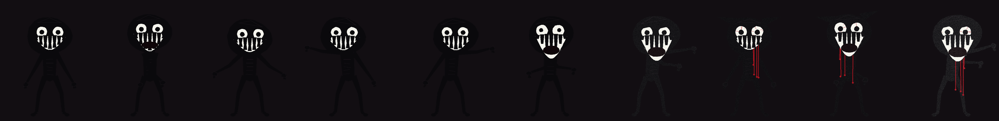

# 🎭 Super Scary Trollge — a Codename Engine mod

**Three songs. One trollge. It gets worse every time.**
A complete, playable [Codename Engine](https://github.com/CodenameCrew/CodenameEngine) mod where the horror
escalates song by song: **2/10 → 4/10 → 7/10**.

Every sprite of the character is **drawn in code** (`tools/trollge_art.py`), the music is **synthesised from the
chart notes themselves** (`tools/make_audio.py`), and every chart, config and atlas in this repo is produced by a
script you can re-run. Nothing is a black box.



| Song | Scare | BPM | Length | Notes (normal) | What happens |
| --- | --- | --- | --- | --- | --- |
| **1. Trolling** | 2/10 | 140 | 104.0 s | 256 | Bouncy, almost friendly. Occasional static flicker. |
| **2. It's Getting Dark** | 4/10 | 150 | 103.6 s | 320 | Minor key, distorted drums, jumpscares, screen shake. |
| **3. Super Scary Trollge** | 7/10 | 160 | 103.5 s | 640 | Tritone riffs, screaming, phase-2 trollge, colour inversion, reality breakdown. |

Both **easy** and **normal** difficulties are charted for all three songs (easy = half density, no sustains).


---

## Install

1. Get [Codename Engine](https://github.com/CodenameCrew/CodenameEngine) and make sure it runs.
2. Grab `SuperScaryTrollge-v2.0.0.zip` from the [releases page](../../releases) (or build it yourself, see below).
3. Drop the **zip** into `mods/` — or extract it so you get `mods/TrollgeMod/data/…`.
4. Launch the engine → **Mods** → pick **Super Scary Trollge**.
5. The week *SUPER SCARY TROLLGE* shows up in story mode, and all three songs are in freeplay.

```
mods/
└── TrollgeMod/
    ├── mod.json
    ├── data/
    │   ├── characters/   trollge.xml, trollge_scary.xml
    │   ├── config/       modpack.ini
    │   ├── scripts/      trollge_behavior.hx, trollge_song_behavior.hx
    │   ├── stages/       trollge.xml, trollge.hx
    │   └── weeks/        weeks/trollge_week.xml, characters/trollge.xml
    ├── images/           characters/, icons/, stages/, menus/, event overlays
    ├── songs/            trolling/, getting_dark/, super_scary/
    └── sounds/           stingers, themes, custom hit/miss
```

> **Codename Engine only.** Psych Engine / YoshiCrafter mods use a different format; this mod uses the
> Codename chart format (`chartVersion 1.6.0`, `codenameChart: true`) and HScript behaviours.

---

## What's inside

### The character

`data/characters/trollge.xml` + `images/characters/Trollge.png` (Sparrow atlas, 21 frames):

`idle` ×2 · `singUP/DOWN/LEFT/RIGHT` · all four `-miss` poses · all four `-alt` poses ·
`scared` · `hey` · `laugh` ×2 · `attack` · `hit` · `die`

A second, nastier atlas (`TrollgeScary`, 17 frames, bloodshot eyes, horns, blood drips, static) is swapped in
mid-song by the `trollgePhase2` event on song 3 — health icon included.

Rendered by `tools/trollge_art.py`: a skeleton (hips, shoulders, knees, elbows, head) is posed per animation and
drawn with wobbly filled polylines, so every pose is a *different drawing* rather than one image being squashed.

### Story events

Charts call HScript functions through `HScript Call` events, implemented in
`data/scripts/trollge_song_behavior.hx`:

| Function | Effect |
| --- | --- |
| `trollgeJumpScare` | Full-screen scream still, stinger, white flash, camera shake |
| `trollgeScreenShake` | Camera + HUD shake with a red flash |
| `trollgeDistort` | Glitch overlay + shake |
| `trollgeStatic` | CRT static burst |
| `trollgeInvert` | Inverted-world overlay while reality flips |
| `trollgePhase2` | Swaps the trollge for its phase-2 form + icon |

Which beats fire when is data-driven: each song has an `events.json` with its own scare schedule
(Trolling: 3 beats, It's Getting Dark: 6, Super Scary Trollge: 12 — including three jumpscares and two inversions).

The stage (`data/stages/trollge.hx`) reads `customValues.scareTier` from the song's `meta.json` and picks one of
three backdrops, plus how much ambient static to flicker:

| Tier | Backdrop |
| --- | --- |
| 2/10 | `bg.png` — dim, quiet |
| 4/10 | `bg_scary.png` — red bleed, scanlines, grain |
| 7/10 | `bg_nightmare.png` — RGB-split, corrupted |

### Audio

All audio is synthesised with numpy (`tools/make_audio.py`) at 44.1 kHz stereo, exported as OGG/Vorbis:

* `songs/<id>/song/Inst.ogg` — the instrumental, **built from the chart notes** (kick/snare/hats, sub bass,
  pads, an arpeggio lead whose pitches come straight from the note ids) with extra horror layers per scare tier:
  tape hiss, dread drone, tritone grit, bitcrushed drums, whisper swells.
* `sounds/trollge_jump_scare.ogg`, `trollge_distortion.ogg`, `trollge_invert.ogg` — event stingers.
* `sounds/trollge_hit.ogg`, `trollge_miss.ogg` — custom note feedback.
* `sounds/trollge_theme.ogg`, `trollge_theme_scary.ogg` — 24 s music-box loops, free to use in menus/cutscenes.

---

## How the charts work

`tools/song_layout.py` is the single source of truth: it defines the BPM, chord progression, section list
(`count` notes per section, `spacing` in 16ths) and story beats for all three songs.
`tools/make_chart.py` and `tools/make_audio.py` both read it, so **the music and the chart can never drift apart**.

Charts are written in Codename's own format:

```json
{
  "stage": "trollge",
  "scrollSpeed": 1.0,
  "chartVersion": "1.6.0",
  "codenameChart": true,
  "bookmarks": [{ "time": 1142.857, "name": "01 - WAKE UP", "color": "#6E0D1B" }],
  "strumLines": [
    { "position": "dad", "type": 0, "characters": ["trollge"], "keyCount": 4,
      "notes": [{ "time": 1142.857, "id": 0, "type": 0, "sLen": 0 }] }
  ]
}
```

Each song ships 16–20 named section bookmarks so the charter shows the song structure at a glance.

---

## Rebuilding the assets

Everything is reproducible. Requirements: Python 3.10+, `pillow`, `numpy`, `soundfile`.

```bash
pip install pillow numpy soundfile

python3 tools/make_art.py     # Trollge atlases, icons, banners, backdrops, overlays (~15 s)
python3 tools/make_audio.py   # 3 instrumentals + stingers + themes (~40 s)
python3 tools/make_chart.py   # meta.json, events.json, charts for all difficulties
python3 tools/validate_mod.py # 327 checks: schemas, atlas bounds, note times, audio length...
python3 tools/package_mod.py  # dist/SuperScaryTrollge-v2.0.0.zip
```

Want a different song? Edit `tools/song_layout.py` (spacings, progression, scare tier, event times) and re-run
the three generators — the chart, the instrumental and the stingers all follow.

---

## CI

`.github/workflows/build.yml` runs on every push and PR:

1. **Validate** — JSON/XML schemas, atlas frame bounds, animation-prefix collisions, note/time sanity,
   `HScript Call` targets actually exist, `Inst.ogg` duration matches the chart length.
2. **Charts in sync** — regenerates the charts and fails if the committed files drifted.
3. **Release** — pushing a `v*` tag builds the zip and publishes it.

---

## Credits

* **Engine:** [Codename Engine](https://github.com/CodenameCrew/CodenameEngine) by CodenameCrew (Apache-2.0).
* **Boyfriend / stage audio-engine conventions:** Friday Night Funkin' by Funkin' Crew.
* **Trollge character art, charts, music, code:** generated by the scripts in `tools/` for this repo (MIT,
  see `LICENSE`).
* **Stage backdrops:** derived from a horror backdrop image in `art_src/scary_bg.png`, graded three ways.

Trollge is an internet meme of unknown origin; this mod is a non-commercial fan project.
