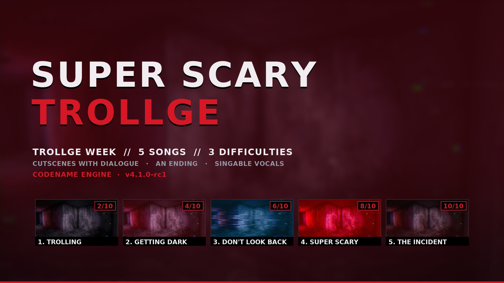
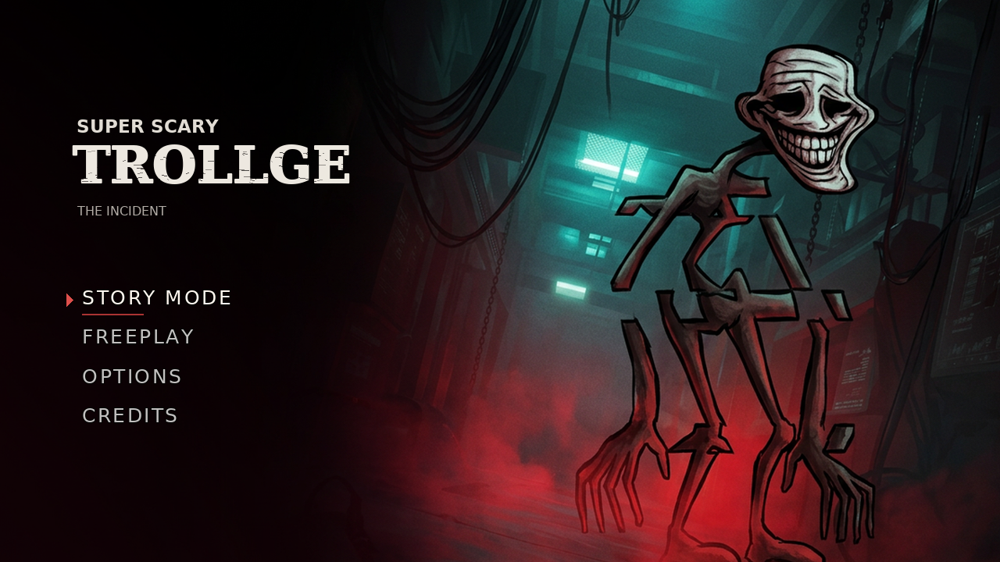
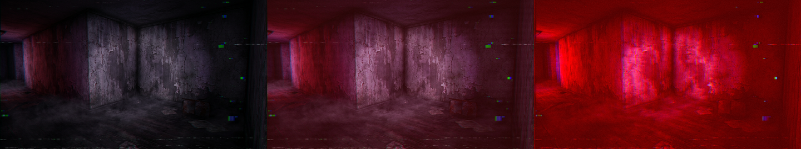
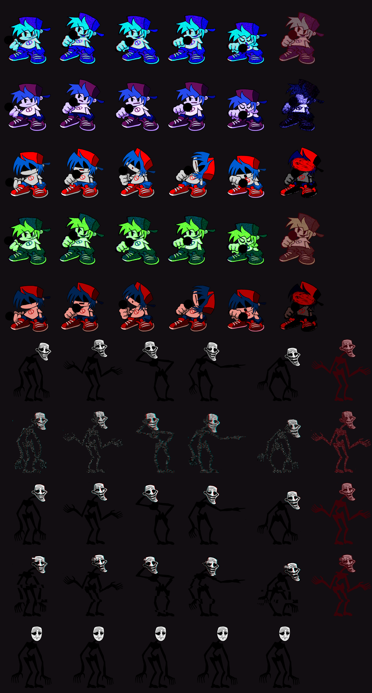
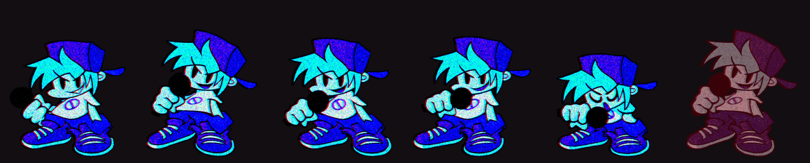
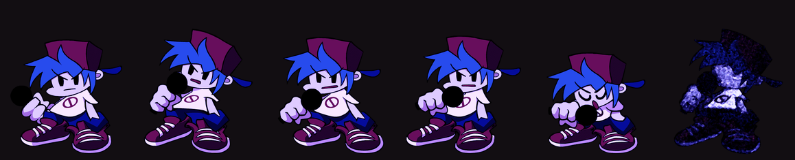

# 🎭 Super Scary Trollge — a Codename Engine mod

**Five songs. One trollge. It gets worse every time.**

[](https://github.com/Skid-ster/FnfModsByarena/actions/workflows/build.yml)
[](../../releases/latest)




A [Codename Engine](https://github.com/CodenameCrew/CodenameEngine) mod where the horror escalates
song by song: **2/10 → 4/10 → 6/10 → 8/10 → 10/10** — and the characters, the arrows, the camera, the menus and the
HUD mutate with it. Five charted, sung, themed songs with hand-written cutscenes, a real ending, and a menu that
looks back at you.

**Launch it and you land in the mod's own menu** — no vanilla "press enter" screen, no base-game death theme, no
default arrows, no default shaders.

**[⬇ Download v4.1.0-rc1 testing release](../../releases/tag/v4.1.0-rc1)** · [install in four steps](#install) · [see what's inside](#whats-inside)

## v4.1.0-rc1: soundtrack, menu and battle testing

The source checkout includes a cinematic menu rebuilt around a user-provided
reference image, redesigned HUD/countdown art, soft contact shadows, bounded
camera punches and steadier HUD during story-event shakes. The design references and limitations
are in [UI research](docs/ui-research.md). Songs with
`needsVoices` use their vocal track instead of doubling each hit with a
second sample. All five song stems have been rebuilt with recorded sung-vowel
chops, reduced competing lead levels, narrower stereo and a gentler vocal mix.
Both characters use different pitches of the same singer; these are not official
BF or Trollge recordings. The published v4.0.0 testing release includes the
menu and earlier vocal mix; the v4.1.0-rc1 testing release adds the soundtrack
rearrangement described below. The latest arrangement adds a different original
three-note piano answer for each song, places those answers in chart vocal rests,
and shapes drum, bass and vocal dynamics around phrase and breakdown boundaries.
Vocal attacks remain chart-locked; tap syllables shorten to leave breathing
room and sustained notes retain their written duration. The charts themselves
have not changed. Equal-gain excerpt mixes are in `previews/music/`; regenerate
them with `python3 tools/make_music_previews.py`.
This pass has not been played or listened to in Codename Engine; flashes,
static and scripted scares are still present.

## v3.9.0 — release and testing status

The CRT shader now performs its warping in camera coordinates and preserves
transparent, premultiplied HUD pixels; the VHS pass also preserves alpha. The
stage preserves other camera filters and removes its own on teardown. Camera
targets have been adjusted after a framing model found a wide singing pose
clipped on the player turn. Captions follow the virtual screen height.

Both shaders compile under desktop GLSL 330/410 and GLES 300 with a **minimal
Flixel-compatible test preamble**; 800 projected character frames clear the
modelled static camera. These are not actual Codename Engine or GPU tests. The
music has not been auditioned in this environment, so please test the songs,
Freeplay, shaders, positioning and effects in your engine build. See the
[development status](docs/development-status.md) and
[music research notes](docs/music-research.md).

## At a glance

| | |
| --- | --- |
| **Engine** | Codename Engine 1.x (HScript behaviours, `chartVersion 1.6.0`) — *not* Psych or YoshiCrafter |
| **Content** | 5 songs × 3 difficulties (easy / normal / hard), story week + freeplay, 5 Trollge phases, 5 Boyfriend skins |
| **Custom everything** | arrow skins ×4, splashes, HUD, health bar, countdown badges, fallback note-hit voices, cutscene art, main menu, death screen, two shaders |
| **Verified** | `tools/validate_mod.py` — **2387 checks, 0 errors, 0 warnings**; `tools/audit_songs.py --strict` — every mix and chart metric inside its window |
| **Sources** | charts and audio use `tools/song_layout.py` and `tools/phrases.py`; art generators also use the existing `art_src/` assets |

## The five songs

| Song | Folder | Key | Scare | BPM | Sound | Length | Notes EZ/NM/HARD | Boyfriend | Trollge | Story beats |
| --- | --- | --- | --- | --- | --- | --- | --- | --- | --- | --- |
| **1. Trolling** | `trolling` | D minor | 2/10 | 140 | 8-bit **bounce** | 1:44 | 80 / 108 / 130 | `bf_blue` | `trollge` | 3 |
| **2. It's Getting Dark** | `getting-dark` | C minor | 4/10 | 150 | half-time **trap** | 1:43 | 97 / 131 / 159 | `bf_smiler` | `trollge` → `trollge_glitch` | 7 |
| **3. Don't Look Back** | `dont-look-back` | C# minor | 6/10 | 152 | **glitch** | 1:51 | 119 / 161 / 191 | `bf_glitched` | `trollge_glitch` → `trollge_static` | 10 |
| **4. Super Scary Trollge** | `super-scary` | B minor | 8/10 | 160 | **industrial** | 1:43 | 124 / 170 / 222 | `bf_super_scary` | `trollge_static` → `trollge_final` → `trollge_sad` | 13 |
| **5. The Incident** | `the-incident` | A minor | 10/10 | 170 | **finale** | 1:48 | 140 / 196 / 249 | `bf_damned` | `trollge_final` → `trollge_sad` | 16 |

Each song also ships its own **arrow skin**, from bright violet/mint to a corrupted glitch atlas:

| Song | Arrow skin | Look |
| --- | --- | --- |
| Trolling | `game/notes/default` | violet, blue, mint and crimson arrows with soft glow |
| It's Getting Dark | `game/notes/shadow` | the same arrows with the colour drained out |
| Don't Look Back | `game/notes/corrupt` | sliced, RGB-split, static-speckled arrows |
| Super Scary Trollge | `game/notes/corrupt` | the same corruption, now with two-lane chords behind it |
| The Incident | `game/notes/torn` | burnt through: ember red, ripped edges, more static |


All three base-game difficulties — **easy, normal, hard** — are charted for every song, with scroll speed rising per
difficulty (1.25 → 2.45 across the pack). Easy and normal follow the same material with fewer notes; notes can be restored to prevent an empty bar.
The finale's **two-lane chords** exist on hard only; easy has no sustains.

Charts are built the way the base game builds them: **one bar (16 steps) belongs to one character**, phrase blocks of
2–4 bars alternate `dad → bf`, the player sings the last phrase, every song opens with an intro block and breathes on
two breakdowns, and note density climbs approximately 1.25 → 2.29 notes/second on the hard charts (130 → 249 notes). Song 5 has the most notes and highest tempo.
The full reasoning, the base-game reference numbers and the engine citations are in **[docs/charting.md](docs/charting.md)**.

### Intended Freeplay list: five songs

The intended Freeplay list is the five Trollge songs in scare order — `trolling`,
`getting-dark`, `dont-look-back`, `super-scary`, `the-incident` — replacing the base game list.
The compatibility paths below are checked statically; actual menu behavior still needs testing on the target engine build:

* the engine asks for `Paths.txt('config/freeplaySonglist/LIB_$modName')`
  (`FreeplayState.hx` → `FreeplaySonglist.getSongsFromSource()`), where `$modName` is the mod's folder name;
* but `LIB_` is a **redirect, not a file name**. `ModsFolderLibrary.__parseAsset` and `ZipFolderLibrary.__parseAsset`
  both rewrite any `LIB_<mod>.<ext>` asset into the plain name beside it, so that request resolves to
  **`data/config/freeplaySonglist.txt`** — and that file is what the engine actually opens;
* so the list ships as `data/config/freeplaySonglist.txt`, and `data/config/freeplaySonglist/LIB_TrollgeMod.txt`
  ships alongside it as a synced compat copy for engine builds that read the prefix literally,
* the older paths `data/freeplaySonglist.txt` and `data/freeplaySonglist/LIB_TrollgeMod.txt` also ship with the same order;
* `modpack.ini` pins `[Flags] SONGS_LIST_MOD_MODE="override"`, the mode that scans this mod's list *instead of* the
  base game's rather than appending to it,
* `tools/validate_mod.py` fails the build if the redirect target is missing, if it is not exactly those five ids in
  scare order, if an id from outside the mod appears, or if the `LIB_` copy ever disagrees with the real list.

These paths are based on source inspection and an archive-level lookup model.
Library naming and scan order vary by engine build, so check both Story and
Freeplay in your Codename installation; the intended order is not guaranteed.

## Previews

| | |
| --- | --- |
|  |  |
| **The mod's own menu** — something is standing in the dark | **Five tiers, one stage** — backdrop, grade and camera per song |
|  |  |
| **The grade** — raw vs graded, one row per scare tier | **HUD mockup** — simulated health fill and countdown badges |



**The cast** — five Boyfriend skins over five Trollge phases, every idle, sing, miss and one-shot pose in the mod.

## Contents

[What's new](#v390--release-and-testing-status) · [The five songs](#the-five-songs) · [Previews](#previews) · [Install](#install) · [What's inside](#whats-inside) · [The menus](#the-menus) · [Cutscenes and the ending](#cutscenes-and-the-ending) · [The death screen](#the-death-screen) · [How the charts work](#how-the-charts-work) · [Rebuilding the assets](#rebuilding-the-assets) · [CI](#ci) · [Credits](#credits)

---

## Install

1. Get [Codename Engine](https://github.com/CodenameCrew/CodenameEngine) and make sure it runs.
2. Grab **`TrollgeMod.zip`** from the [releases page](../../releases), or build
   the source checkout locally. The versioned ZIP is identical to
   its matching `TrollgeMod.zip`; **install from `TrollgeMod.zip`** (see below).
3. Drop that **zip** into `mods/` — or extract it so you get `mods/TrollgeMod/data/…`.
4. Launch the engine → **Mods** → pick **TrollgeMod**.
5. The week *SUPER SCARY TROLLGE* shows up in story mode, and all five songs are in freeplay.

### Installing the zip

Use `TrollgeMod.zip` (or the extracted `TrollgeMod` folder) to match the literal
`LIB_TrollgeMod` compatibility copies. The library name passed by Codename can
vary between engine builds; rewriting builds can resolve single-component names
to the plain list, whereas a path-like name may trigger the engine's song-folder
scan. The scan can find the songs but does not guarantee scare order. These cases
are simulated by `tools/check_freeplay_zip.py`; they still require in-engine tests.

```
mods/
└── TrollgeMod/
    ├── mod.json
    ├── data/
    │   ├── characters/   trollge.xml, trollge_glitch.xml, trollge_static.xml,
    │   │                 trollge_final.xml, trollge_sad.xml,
    │   │                 bf_blue.xml, bf_smiler.xml, bf_glitched.xml,
    │   │                 bf_super_scary.xml, bf_damned.xml (+ _dead variants)
    │   ├── config/       modpack.ini, freeplaySonglist/LIB_TrollgeMod.txt
    │   │                 (the freeplay *replacement* list: five songs, scare order)
    │   ├── scripts/      trollge_behavior.hx, trollge_song_behavior.hx
    │   ├── splashes/     default.xml (note splash config)
    │   ├── stages/       trollge.xml, trollge.hx (stage, shaders, voices)
    │   └── weeks/        weeks/trollge_week.xml, characters/trollge.xml
    ├── images/           characters/, icons/, stages/, event overlays,
    │                     menus/ (mainmenu buttons + menuBG),
    │                     game/notes/{default,shadow,corrupt,torn}, game/splashes,
    │                     game/healthBar.png, game/{ready,set,go}.png
    ├── songs/            trolling/, getting-dark/, dont-look-back/,
    │                     super-scary/, the-incident/  (song/Inst.ogg +
    │                     song/Voices.ogg + charts/{easy,normal,hard}.json +
    │                     cutscene.hx + cutscene-end.hx)
    ├── shaders/          trollge_vhs.frag (VHS grade) + crt.frag (CRT pass)
    ├── music/            gameOver.ogg/.ini (death theme + BPM), trollgeMenu.ogg
    │                     (menu loop, via [Flags] DEFAULT_MENU_MUSIC)
    └── sounds/           stingers, themes, countdown hits, custom hit/miss,
                          per-character note voices, game-over sting/retry
```

> **Codename Engine only.** Psych Engine / YoshiCrafter mods use a different format; this mod uses the
> Codename chart format (`chartVersion 1.6.0`, `codenameChart: true`) and HScript behaviours.

---

## What's inside

### The Trollge — five phases, one character

All Trollge art is hand-drawn and imported from `art_src/trollge/` by `tools/make_characters.py`:

| Phase | Art | Used by |
| --- | --- | --- |
| `trollge` | `trollge.png` — clean grin, hunched, clawed hands | song 1; song 2 (0–62 s) |
| `trollge_glitch` | `trollgeGlitch.png` — RGB-split, breaking apart | song 2 (62 s →); song 3 (0–75 s) |
| `trollge_static` | `trollgeStatic1.png` — hatched, buzzing with static | song 3 (75 s →); song 4 (0–60 s) |
| `trollge_final` | `TrollgeFinal.png` — red-eyed final form | song 4 (60–96 s); song 5 (0–84 s) |
| `trollge_sad` | `trollgesad.png` — one pose. he just stands there. | song 4 (96 s →); song 5 (84 s →) |

Every phase ships `idle`, all four sing poses, all four **miss** poses, `scared`, `laugh`, `attack`, `hit`,
`die` and its own health icon. The importer:

* renames frames to collision-free codes (`TrollgeF sUP0000`) so `addByPrefix` can never fold a miss pose
  into a sing animation,
* rebuilds `singRIGHT` by mirroring `singLEFT` — **the uploaded right-sing frames are a sprawled, upside-down
  figure**, so they are unusable,
* derives the miss poses (desaturated, blood-washed) because the uploads contain none,
* normalises everything onto one ground line and one body height, so a phase swap at 60 s cannot make him
  jump, grow or slide.

### The Boyfriend — one skin per song





`bf_blue` (song 1) → `bf_smiler` (song 2) → `bf_glitched` (song 3) → `bf_super_scary` (song 4) → `bf_damned`
(song 5). Songs 1–2 are imported straight from `art_src/bf/`; songs 3 and 5 are **re-coloured** from the same two
uploads with the importer's `tint` pass (`bf_glitched` = the blue boy gone sickly green, `bf_damned` = the crazy
boy burnt red and desaturated) — a real second cast without a second upload. The blue skin has no miss art in its
upload, so the importer grades its sing poses into blood-washed miss poses; every skin also gets a game-over sprite
(`gameOverChar`) and a two-frame health icon.

`tools/make_characters.py` is the only thing that writes character atlases/XML/icons:

```bash
python3 tools/make_characters.py                 # rebuild every character
python3 tools/make_characters.py trollge_final   # just one
```

### Story events

Charts call HScript functions through `HScript Call` events, implemented in
`data/scripts/trollge_song_behavior.hx`:

| Function | Effect |
| --- | --- |
| `trollgeJumpScare` | Full-screen scream built from the trollge's **own face**, stinger, white flash, camera shake |
| `trollgeToGlitch` | 62 s of song 2: the clean trollge corrupts where he stands |
| `trollgeToStatic` | 75 s of song 3: phase 2 collapses into phase 3 |
| `trollgeFinalForm` | 60 s of song 4: static mess → red-eyed final form, with a stinger + hard shake |
| `trollgeToSad` / `trollgeSad` | 84 s of song 5 / 96 s of song 4: he stops fighting. One pose. Stillness. |
| `trollgeScreenShake` | Game camera shake with a game-camera red flash |
| `trollgeDistort` | Glitch overlay + shake |
| `trollgeStatic` | CRT static burst |
| `trollgeInvert` | Corrupted-frame overlay while reality flips |

Which beats fire when is data-driven: each song has an `events.json` with its own scare schedule
(Trolling: 3 beats, It's Getting Dark: 7, Don't Look Back: 10, Super Scary Trollge: 13, The Incident: 16).

The stage (`data/stages/trollge.hx`) reads `customValues.scareTier` from the song's `meta.json` and picks one of
five backdrops, plus how much ambient static to flicker:

| Tier | Backdrop |
| --- | --- |
| 2/10 | `bg.png` — dim, quiet |
| 4/10 | `bg_scary.png` — red bleed, scanlines, grain |
| 6/10 | `bg_glitch.png` — the room double-exposing on itself |
| 8/10 | `bg_nightmare.png` — RGB-split, corrupted |
| 10/10 | `bg_hell.png` — the original photograph, burning |

### Arrows, splashes and the HUD

The note skin is drawn in code by `tools/make_noteskin.py` (no borrowed FNF art) and follows the engine's
87-frame naming so it drops straight in:

* `images/game/notes/default.png/.xml` — 49 frames: idle strums (`arrowLEFT`…), `left press` and
  `left confirm` (4 frames each), the four scrolling notes (`purple`…`red`), hold bodies and hold caps.
* `images/game/notes/shadow.png/.xml` — same layout, colour drained (song 2).
* `images/game/notes/corrupt.png/.xml` — same layout, glitched (songs 3–4).
* `images/game/notes/torn.png/.xml` — same layout, burnt to ember and ripped (song 5).
* `images/game/splashes/default.png/.xml` + `data/splashes/default.xml` — the burst that fires when a note is
  hit, per lane, 4 frames each.

Every frame went through the same legibility pass, because the old bodies went almost black at the tip and
disappeared on the darker stages:

* **notes** carry a bright interior core (the lane colour lifted towards white, blurred into the fill) and a hotter
  keyline — measured on the shipped atlas, mean interior luminance roughly doubled:

  | lane | interior luminance (v3.6.0) |
  | --- | --- |
  | purple / left | 58.8 → 122.0 |
  | blue / down | 71.7 → 132.7 |
  | green / up | 94.6 → 153.9 |
  | red / right | 53.2 → 116.5 |

* **receptors** (`arrowLEFT`…) keep their dark body — a note has to read as brighter than the thing it lands on — but
  gained a glowing inner core, a broken static rim and a white keyline, lifting them from 50.6 to 72.1 without
  competing with the notes.
* **confirm** frames were clipping their expanding ring, because the ring was drawn straight into a 200 px canvas at
  1.55× scale and lost its wings. The ring now renders on a 1.7× canvas and is resized down, and every confirm frame
  gets a white-hot inner flash that decays across the four frames.
* **the shadow skin** gets a cold metallic rim, a specular streak and a little static instead of being a flat desaturate.
* **the torn skin** retains the four lane colours beneath its ember tint, with a brighter centre, red/cyan fringe,
  CRT rows, ink runs and burnt edges. This avoids the old near-monochrome red arrows on the final dark stage.
* **holds** use a continuous centre rail and repeatable edge-to-edge body tiles, with a matching tapered end cap.

The 4.1.0-rc1 visual pass fixes a scratch mask that dimmed the whole
arrow, strengthens the dark outline, preserves lane colour through corruption,
and keeps note animation frames inside their existing engine-sized canvases.
[Battle preview](docs/battle_preview.png) is a static atlas composite at an
approximate 0.7 scale, not a screenshot or shader render.

How each song gets its skin:

1. The chart's `noteTypes` list names the atlas (`["shadow"]`, `["corrupt"]`, `["torn"]`, `[]` = default). The engine maps
   note type `0` onto that name and loads `game/notes/<name>` — see `Note.hx`.
2. Strums always load `game/notes/default`, so `data/stages/trollge.hx` implements `onStrumCreation` and swaps
   `event.sprite` to the same atlas, keyed off the song's `customValues.scareTier`.

The HUD is themeable by filename alone, so `tools/make_hud.py` ships:

* `images/game/healthBar.png` — an instrument casing; the engine draws the dynamic `FlxBar` 4 px inside it,
  and repaints it to the new form's `iconColor` during Trollge swaps.
* `images/game/ready.png`, `set.png`, `go.png` — matching transmission-console placards with clear, undistorted words.
* `sounds/intro3.ogg`, `intro2.ogg`, `intro1.ogg`, `introGo.ogg` — matching countdown hits, rising in pitch
  and ending in a distorted blast.


This is an asset mockup, not a game screenshot: the fill colours are simulated.

### Positioning and camera

The stage is not hand-placed and hoped for: `tools/make_stage_preview.py` re-implements the engine's framing
(`FlxAtlasFrames` frame offsets → `Character.__getCameraPositionInto` → `FlxCamera` zoom/scroll) and renders
`docs/stage.png` — one tile per camera side, with the ground line and each character's safe frame drawn in.


It prints the clear space around the two idle characters at the stage zoom and a modelled zoom of 1.05,
and fails if those idle poses are clipped, if their feet are more than 2 px apart, or if the backdrop does not
cover what the camera can see. The numbers it validates:

| Setting | Value | Why |
| --- | --- | --- |
| ground line | Trollge `y=60`, Boyfriend `y=82` | the two atlases have different canvas heights (600 vs 560), so the y offset is exactly their baseline difference — the feet land on the same line to the pixel |
| character gap | 520 px | camera offsets keep the projected animation frames in view at the modelled zooms |
| camera offsets | dad `+20, +75`; boyfriend `-80, +75` | keeps wide poses and feet within the modelled camera frame |
| `zoom` | 0.95 → 1.026 | the stage's 0.95 plus 0.0095 per scare step: song 1 is framed loose, song 5 is pressed in |

Camera work lives in `data/stages/trollge.hx` and scales with the scare tier:

* restrained pushes on beats, every fourth measure and non-sustain note hits;
* this stage's impulses are capped at `defaultCamZoom + 0.018` and the engine
  lerps back toward the base. Engine or chart zooms may exceed that cap;
* game-camera shake on every fourth beat from tier 6, plus scripted event
  shakes. Story-event shakes no longer shake the HUD;
* soft, fixed world-space contact shadows sit behind both characters. They do
  not follow animation poses or dynamic character movement.

The expanded frame model checks all 800 projected battle frames at 0.95 and
1.05 zoom; its narrowest margin is 48.8 px. It does not model camera motion,
other scripts' zooms, HUD overlap, shaders or actual in-engine rendering.

### Note-hit voices

The shipped songs have `needsVoices: true` and use their chart-matched
`Voices.ogg` without layering an extra syllable over every note. For songs
whose metadata explicitly says `needsVoices: false`, the stage can fall back
to short character-specific samples. Their pitch follows the arrow:

| Side | Sound | Files |
| --- | --- | --- |
| Player | bright nasal syllable | `sounds/bf_note_{up,down,left,right}.ogg` |
| Opponent | low growling syllable | `sounds/trollge_note_{up,down,left,right}.ogg` |

They are synthesised in `tools/make_audio.py` (`render_note_voices()`), triggered from the stage script's
`onNoteHit` hook only in that fallback case, and skipped for sustain ticks. The
engine controls the sing poses and vocal playback; actual timing and mix still
need listening tests.

### Audio

Audio is rendered by `tools/make_audio.py` at 44.1 kHz stereo and exported as OGG/Vorbis. The song vocals and piano use recorded CC0 samples; the other instruments and effects are synthesized.

**The 4.1.0-rc1 arrangements** take inspiration from the emotional
contrast of *The Trollge Files*: five original piano figures and short answers
after vocal rests, a different rise/retreat curve for each song, and quieter
early endings. Chords follow the existing chart harmony, and the existing vocal
melodies and timings have not been rewritten. Neither music nor samples from
*The Trollge Files* are copied into the mod. See [the research notes](docs/music-research.md).

**The instrumentals are programmed from the chart notes**: hits get a
deterministic timing nudge and velocity (swing on the off-16ths, a few milliseconds of human drift), the pads carry a
seventh with a slowly moving filter, ghost snares and open hats fill the space between the drums, an eight-bar fill
lands into every new role, the lead is doubled an octave down for weight, and the master runs tape saturation plus a
parallel-compressed mid so the drums feel loud without flattening the dynamics. Each song is arranged by *section role* — the renderer labels
every chart section and gives it a part, so the songs build, drop and breathe instead of looping one drum pattern:

| Role | Where it lands | What plays |
| --- | --- | --- |
| `intro` | section 1 | pad, one kick, off-beat hats, no snare |
| `verse` | most sections | kick on 1 + 3, snare on 2 + 4, 8th hats, walking bass |
| `build` | every 4th section | verse + 16th hats and a busier bass |
| `drop` | blocks with 16th-note cells | syncopated 16th bass, extra kicks, 16th hats, air sizzle |
| `break` | mid-song + just before the finale | half-time heartbeat, open hats, most of the mix gone |
| `finale` | last two sections | drop + octave-doubled lead |

**Five songs, five bands.** The songs do not share instruments — same renderer, different kit, bass voice, lead voice
and groove (`"style"` in `tools/song_layout.py`, voices in `tools/make_audio.py`):

| Style | Kit | Bass | Lead | Groove |
| --- | --- | --- | --- | --- |
| `bounce` (song 1) | punchy kick, layered **clap**, open hats, woodblock answers | plucked saw, 8th-note bounce | pulse-wave **chip** lead | straight backbeat, off-beat bass |
| `trap` (song 2) | long **808** boom, rim-shot snare, rolling/ triplet hats | sliding 808 sub, long notes | two-operator **FM bell** with a tail | half-time, reversed cymbals |
| `glitch` (song 3) | clipped sub thump, gate-stuttered snare, hat holes and 32nd stutters | root-pitched rhythmic gating | hard-edged square lead with random dropouts | broken beat: kick on 1 and the "a" of 2 |
| `industrial` (song 4) | metal beater on the kick, ghost snares, 16th ride | warm detuned saw, 16ths | screaming saw + tritone | four-on-the-floor, noise bursts |
| `finale` (song 5) | double kick, blast-beat snares, 16th rolls, gong hits | sub + growling saw octave | choir of detuned saws with fifths | driving 8ths with a fifth stab |

`tools/audit_songs.py` measures that separation too: the minimum pairwise song "fingerprint" distance (band energy +
centroid + onset rate) has to stay above 0.10, see the generated song report for the latest value.

On top of that: snare fills and a riser + crash into every section that gets bigger, a horror layer per scare tier
(dread drone → tape hiss → whisper swells → a breathing, detuned tritone → heartbeat, whispers and a choir root),
scripted stingers behind `HScript Call` events, and ending chords whose impact
is softer in the early songs.

**Vocals.** Both voices are pitched and enveloped from Bart Massey’s CC0 sung
note, not the official Boyfriend chromatic or a Trollge actor. The opponent sings
an octave below the written melody. Repeated short vowel chops are deliberately
stylized and may not sound like the original characters; please audition them.

**Mixing and mastering.** Instruments and voices are generated as separate stereo
tracks. The instrumental uses EQ, sidechain, compression and stereo widening;
then a linked gain envelope gives the decoded `Inst.ogg` + `Voices.ogg` sum
headroom at equal playback gain without changing their relative balance. Vorbis
encoding is checked again after decoding. `tools/check_stem_mix.py` reports a
4× Catmull-Rom inter-sample peak **estimate**, not a standards-compliant true
peak measurement or proof of how a particular engine mixes the stems.

`tools/audit_songs.py` and the other reports check the shipped files, chart
shape, spectral proxies and dynamics. See [`docs/song_report.md`](docs/song_report.md).
Numbers are not a substitute for listening or gameplay.

* `songs/<id>/song/Inst.ogg` — programmed instrumental and lead, using the chart's written pitches.
* `sounds/trollge_jump_scare.ogg`, `trollge_distortion.ogg`, `trollge_invert.ogg` — event stingers.
* `sounds/trollge_hit.ogg`, `trollge_miss.ogg` — custom note feedback.
* `sounds/trollge_theme.ogg`, `trollge_theme_scary.ogg` — 24 s music-box loops, free to use in menus/cutscenes.
* `sounds/intro3.ogg`, `intro2.ogg`, `intro1.ogg`, `introGo.ogg` — the countdown: three tuned hits and a blast.

### Screen grade (shaders)

`shaders/trollge_vhs.frag` is a full-screen post filter applied to `camGame` by `data/stages/trollge.hx`:

* banded VHS wobble, radial chromatic aberration, a 5-tap **halation** glow on highlights, drifting scanlines,
  film grain, vignette, then a small contrast/saturation lift so the grade sharpens the picture instead of washing
  it out;
* intensity follows the scare tier (0.35 / 0.51 / 0.67 / 0.83 / 1.0) and every story event in the chart (`trollgeJumpScare`,
  `trollgeInvert`, `trollgePhase2`…) punches `uGlitch` for 1.2 s; songs 4 and 5 also twitch on every beat;
* all sampling is **clamped to the texture**, so the offsets never pull from outside the frame — that was causing
  the edges of the screen to smear/clip on the first pass;
* the stage script resolves `FunkinShader` and `openfl.filters.ShaderFilter` at runtime and silently disables the
  grade if the platform has no GPU path; this fallback still needs an in-engine test.


`tools/make_grade_preview.py` reproduces the shader maths in numpy (same uniforms, same order) and renders
`docs/grade.png` — raw backdrop on the left, graded on the right, one row per scare tier — so the look can be
reviewed without launching the engine.

`shaders/crt.frag` is a second, independent pass on top of it — a real CRT rather than a tape wobble:

* barrel curvature (pixels outside the tube become transparent, including on the HUD), red/blue chromatic
  aberration sampled per channel, horizontal tear bands while a glitch is up, scanlines, animated static grain and a
  corner vignette, in that order;
* it is applied **twice**: `camGame` gets the VHS and CRT filters, while `camHUD` gets subtle scanlines only;
  HUD curvature, tears, grain, vignette and channel split are disabled to keep note geometry stable;
* the ladder is `base = (scareTier - 2) / 8`, so 2/10 is a barely-there tube, 4/10 shows the scanlines, 6/10 starts
  splitting channels and 10/10 is a broken set — and `trollgeDistort` / `trollgeStatic` punch `uGlitch` on top;
* uniforms are written per frame from `update(elapsed)` through one guarded setter, and every load, filter creation and
  uniform write sits inside its own `try/catch`, intended to let the song run without the effect if compilation fails.
  Both `uTime` and `iTime` are driven; actual shader compilation and display still require an engine test. (Psych mods call this
  `CustomShader("crt")`; in Codename the same thing is `FunkinShader.fromFile('crt')` + `openfl.filters.ShaderFilter`.)

The validator checks both shader files for `#pragma header`, a `main()`, no `switch` statements, no reversed
`smoothstep` edges, and that every uniform they declare is actually set by the stage script; for `crt.frag` it also
requires the OpenFL conventions (`openfl_TextureCoordv`, `openfl_TextureSize`, `openfl_Alphav`,
`getCamPos` and `textureCam(bitmap, …)`); it rejects direct `flixel_texture2D` and raw bitmap fetches in the CRT camera filter, and checks attachment to both cameras. The separate GLSL test compiles each shader using a minimal interface, not OpenFL's complete runtime assembler or a GPU.

---

## The menus

Launching the mod does not take you through vanilla FNF. `data/config/modpack.ini` redirects the title screen:

```ini
[StateRedirects]
TitleState="funkin.menus.MainMenuState"
```

`GlobalScript`'s `preStateSwitch` hook resolves that value with `Type.resolveClass`, so it has to be the **full class
path** — a short name like `MainMenuState` does not resolve, and the engine would then look for a
`data/states/MainMenuState/LIB_<mod>.hx` state loader, which is not a replacement for the class itself and can vary
with the mod library name, leaving you on a black screen. Prefer landing in the song list instead? Point it at `"funkin.menus.FreeplayState"`.

The cinematic menu uses an original AI-generated Trollge hallway scene inspired
by the supplied reference image: a shadowed left column, distressed title,
minimal stacked navigation and a red-and-teal scene. The actual four choices and
navigation remain in the engine. `tools/make_menu.py` builds the artwork from
`art_src/menu_scene.png`; the layout script is
`data/states/MainMenuState/LIB_TrollgeMod.hx`.

Install as **TrollgeMod** and use a Codename build with state scripts enabled for
the left-aligned layout. If the script does not load or cannot access the engine's
menu group, the stock engine layout remains usable but the layout and title can
be different. The preview is a static approximation; it does not show engine
camera parallax, version text, actual transitions or prove the script runs.
The menu uses raster text, which is not resizable or screen-reader accessible.
See [UI research](docs/ui-research.md) for references and limitations.


Menu music is the mod's too — `[Flags] DEFAULT_MENU_MUSIC="trollgeMenu"` points `CoolUtil.playMenuSong()` at
`music/trollgeMenu.ogg`, the same 24 s music-box loop the cutscenes use.

## Cutscenes and the ending

Codename looks for cutscenes by itself, so all of it is data:

```
songs/<song>/cutscene.hx        PlayState.createPost -> startCutscene(...)   (intro, Story Mode)
songs/<song>/cutscene-end.hx    PlayState -> startCutscene("end-", ...)      (outro, Story Mode)
images/ui/cutscene_frame*.png   the dialogue frame          images/ui/cutscene_bar_*.png   letterbox
images/ui/cutscene_veil.png     the ending veil
```

The intro is a short cinematic before the countdown: letterbox bars slide in, the song title lands, then the Trollge
and BF trade typed lines in VCR with a speakers label, a stinger and a **camera shake on the lines that deserve one**
(`SHAKES` in `tools/song_layout.py`). `ENTER` / `SPACE` / `ESC` skips. The HUD is hidden for the duration and restored
in `destroy()`, and everything draws on its own camera so the stage keeps animating behind it.

**In-song captions.** The story does not stop when the countdown does: each song carries three to five caption beats
(`"captions"` in `tools/song_layout.py`) that are emitted as chart events and typed across the bottom of the screen
while you play — `don't look back`, `you looked`, `the first scream`, `goodbye`. They use the HUD camera; their placement and possible overlap still need engine testing. They don't block
input, and fade themselves out.

The outro runs after the last note. For songs 1–4 it is one line of falling action; **The Incident** gets the real
ending: the screen fades under the final chord and `GOODBYE.` / `he stopped fighting.` / `the incident is over.` /
`…or maybe it never ended.` type themselves out before control returns to the engine.


Both scripts are generated by `tools/make_cutscenes.py` from `tools/song_layout.py`, so the copy you read and the copy
the audio was built from cannot drift — and `tools/validate_mod.py` checks the scripts reference images and sounds that
actually ship, restore the HUD, and free their camera.

## The death screen

Codename's game-over state is three files and one ini, so the mod ships all four:

```
music/gameOver.ogg     a 16 s dirge: D minor drone, a tritone that will not resolve,
music/gameOver.ini     heartbeat, a music box playing the Trollge motif a semitone wrong   (BPM = 76)
sounds/gameOverSFX.ogg the mic drop -- sub hit, static burst, a ringing tone
sounds/gameOverEnd.ogg the retry whoosh
```

`tools/validate_mod.py` checks all four exist, that the ini actually carries a BPM, and that the durations are sane —
because a missing file silently falls back to the base game's death theme, which is the loudest "unfinished" tell a
mod can have.

## How the charts work

`tools/song_layout.py` is the single source of truth: it defines the BPM, the key, the chord progression, the phrase
blocks (`section_measures` in bars), the rhythm cell of each block (`cells`), the difficulty filters, the characters
each song uses, and the story beats for all five songs. `tools/make_chart.py` and `tools/make_audio.py` both read it, so **the music and the chart can
never drift apart**.

Charts are written in Codename's own format:

```json
{
  "stage": "trollge",
  "scrollSpeed": 1.0,
  "chartVersion": "1.6.0",
  "codenameChart": true,
  "bookmarks": [{ "time": 1142.857, "name": "01 - WAKE UP", "color": "#6E0D1B" }],
  "strumLines": [
    { "position": "dad", "type": 0, "characters": ["trollge_static"], "keyCount": 4,
      "notes": [{ "time": 1142.857, "id": 0, "type": 0, "sLen": 0 }] }
  ]
}
```

Each song ships 16–28 named phrase bookmarks (marked `(dad)` when the opponent sings) so the editor shows the song
structure at a glance, plus its own `song/Voices.ogg` — the characters actually sing, which is what `needsVoices`
gates in `PlayState.hx`.

### Phrases, not hooks: why the chart is the melody

The songs are written as **phrases** in `tools/phrases.py` — plain text, one line per bar of sixteen 16th steps, a
number being a semitone above the song's tonic, `.` a rest and `-` a tie. Each song has:

* an A section built as **ABA‑C**: a riff, an answer to it, the riff restated (so there is something to recognise),
  and a varied answer that cadences — `verse_a` states, `verse_b` answers a step higher;
* a B section in a new register (`verse_c`/`verse_d`), same key, the same shapes moved up a third;
* a **chorus** (`chorus_a`/`chorus_b`) where the riff is at its most insistent and the cadence lands on the tonic;
* a build, a two-note **breakdown**, and a **finale** that restates the chorus an octave up.

`tools/song_layout.py` lays those phrases over the chart's phrase blocks (`form`), so the opponent sings the
antecedents and the player the consequents. Every fourth exchange mirrors the
player's **lanes**, not the melody pitches; the form uses call and response.

**The harmony is derived from the melody.** `harmonise()` scores every diatonic chord (triads, then sevenths, then the
two suspensions) against the notes each bar actually sings, weighting beats seven times as heavily as off-beats and
giving the bar's downbeat its own term; the song's own progression is kept as the tie-breaker, so the key still
sounds like the song's. This is the order an arranger works in — write the tune, then harmonise it — and it replaced a
fixed 8-bar loop that ran off the absolute bar number, which meant the same phrase came back over a different chord
each time and no melody could be *written* against it.

Two details make it chartable:

* **the lane is a degree class, the pitch is the phrase's own semitone.** A note carries `lane` (tonic / flat third /
  fifth / flat seventh — the four arrows) and `semi` (what the singer sings). `note_pitch()` preserves the
  written pitch class without snapping it to the bar's chord (the opponent vocal is an octave lower), so the melody can step by semitone while the chart stays four arrows;
* **a phrase may not reuse a lane within two 16ths**, so an octave leap cannot turn into a jack — the note takes the
  nearest free lane and keeps its register, and `_break_jacks()` is the last guard.

`tools/melody_report.py` measures the result on the notes that are actually played (each note scored under the chord
of the bar it lands in, which is not the same thing as scoring the notation against an assumed offset):

| song | notes | on-chord | chord tones | stepwise | leaps answered | bars restated | range |
|---|---|---|---|---|---|---|---|
| trolling | 130 | 100 % | 98 % | 75 % | 93 % | 32 % | 19 st |
| getting-dark | 159 | 100 % | 92 % | 80 % | 70 % | 71 % | 19 st |
| dont-look-back | 191 | 98 % | 96 % | 66 % | 69 % | 82 % | 20 st |
| super-scary | 206 | 85 % | 81 % | 94 % | 62 % | 78 % | 15 st |
| the-incident | 237 | 90 % | 81 % | 92 % | 73 % | 89 % | 18 st |

Each difficulty is a strided subset of the same melody (hard 130 / 159 / 191 / 222 / 249 notes; easy keeps a stride through
the same notes and carries no sustains), and a stride may never empty a bar — where it did, the bar's downbeat is put
back, because a silent bar is a hole in the song rather than an easier chart.

---

## Rebuilding the assets

Everything is reproducible. Requirements: Python 3.10+, `pillow`, `numpy`, `soundfile`.

```bash
pip install pillow numpy soundfile

python3 tools/make_characters.py  # imported atlases -> normalised atlases, icons, character XML (~25 s)
python3 tools/make_art.py         # backdrops, VHS overlays, week banner, previews (~10 s)
python3 tools/make_audio.py       # 5 instrumentals + 5 vocal tracks + stingers/themes/note voices (~18 min)
python3 tools/make_noteskin.py    # arrow skins (default/shadow/corrupt/torn) + splashes
python3 tools/make_battle_preview.py # approximate static atlas composite
python3 tools/make_hud.py         # health bar frame + READY/SET/GO badges
python3 tools/make_chart.py       # meta.json, events.json, charts {easy,normal,hard}
python3 tools/make_cutscenes.py   # cutscene scripts + their frames/letterbox art (~2 s)
python3 tools/make_menu.py        # main menu buttons + backdrop (~1 s)
python3 tools/make_promo.py       # docs/banner.jpg from the real stage art (~1 s)
python3 tools/make_contact_shadow.py # regenerate the fixed ground shadow
python3 tools/make_stage_preview.py  # approximate idle framing -> docs/stage.png + margin report
python3 tools/test_stage_bounds.py   # projected bounds for all battle animation frames
python3 tools/test_glsl_compile.py   # needs glslangValidator; minimal-preamble GLSL compile
python3 tools/make_grade_preview.py  # re-renders the shader maths in numpy -> docs/grade.png
python3 tools/validate_mod.py     # 2387 checks: schemas, atlas bounds, skins, HUD, note times, audio length, one character per bar...
python3 tools/audit_songs.py      # mix + chart-style metrics -> docs/song_report.md (--strict for CI)
python3 tools/melody_report.py    # hard-chart melody metrics (--strict for CI)
python3 tools/test_music.py       # pitch, harmony, arrangement and stem-gain regressions
python3 tools/check_stem_mix.py  # decoded equal-gain stem-sum peak estimate
python3 tools/dread_report.py     # dread-band spectral proxy with 3 dB tolerance (--strict for CI)
python3 tools/package_mod.py      # dist/TrollgeMod.zip + dist/SuperScaryTrollge-v4.1.0-rc1.zip
                                  # (175 files, includes shaders/ + music/; install the TrollgeMod one)
```

Two files are hand-written rather than generated — `shaders/trollge_vhs.frag` and `shaders/crt.frag`. The validator
reads them as source: GLSL conventions, uniform contract, and the stage script that attaches them.

Want a different song? Edit `tools/song_layout.py` (phrase blocks, rhythm cells, progression, key, scare tier, event
times) and re-run the generators — the charts, the instrumental, the vocal track, the week and the freeplay list all
follow.

---

## CI

`.github/workflows/build.yml` runs on every push and PR:

1. **Validate** — JSON/XML schemas, atlas frame bounds, animation-prefix collisions, note/time sanity,
   `HScript Call` targets actually exist, every chart character + animation resolves, `Inst.ogg` duration
   matches the chart length, note-skin frame sets match across skins, splash anims resolve in their atlas,
   HUD art is sane, both shaders honour the uniform contract, and **this README is true**: its links resolve,
   it names the zip of the current `mod.json` version, and the check tally it quotes matches the run. Then `tools/audit_songs.py --strict` measures the mix (loudness, dynamics, spectral
   balance, stereo width, clipping) and the chart style (off-beat ratio, jacks, density escalation).
2. **Charts in sync** — regenerates the charts and fails if the committed files drifted.
3. **Release** — pushing a `v*` tag builds the zip and publishes it.

---

## Credits

* **Engine:** [Codename Engine](https://github.com/CodenameCrew/CodenameEngine) by CodenameCrew (Apache-2.0).
* **Boyfriend / stage audio-engine conventions:** Friday Night Funkin' by Funkin' Crew.
* **Trollge and Boyfriend art (`art_src/`):** drawn by the project owner and imported unchanged by
  `tools/make_characters.py` — credited to them, not covered by this repo's MIT licence.
* **Piano samples:** [Meta Piano](https://github.com/facebookincubator/Meta-open-sound/tree/main/systems/instruments/meta-piano) (CC0), retuned, trimmed and enveloped for the new arrangements.
* **Sung-vowel source:** [Bart Massey, voice-note.wav](https://github.com/pdx-cs-sound/wavs/blob/main/voice-note.wav) (CC0); modified through trimming, filtering, looping, pitch shifting and envelopes for the song vocals.
* **Charts, original compositions, scripts, backdrops, overlays, tooling:** made for this repo (MIT, see `LICENSE`); the recorded vocal source is separately licensed as noted above.
* **Stage backdrops:** graded from a horror backdrop image in `art_src/scary_bg.png`.

Trollge is an internet meme of unknown origin; this mod is a non-commercial fan project.
