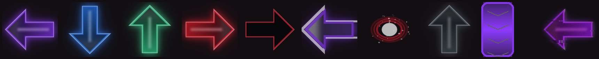
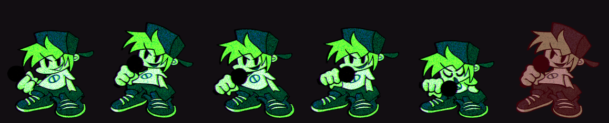
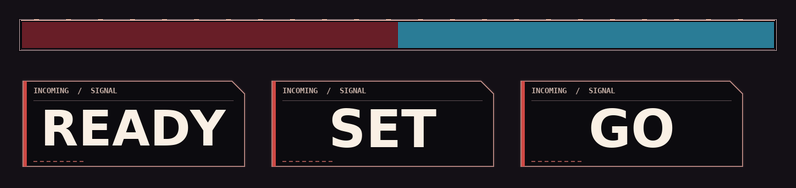
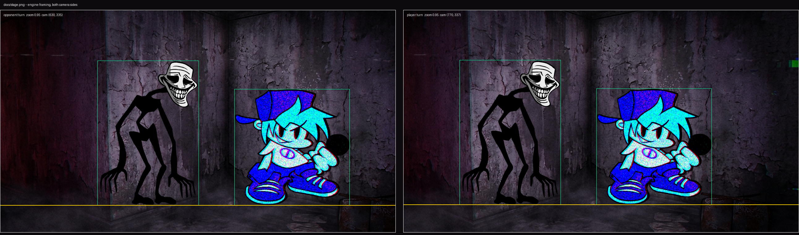
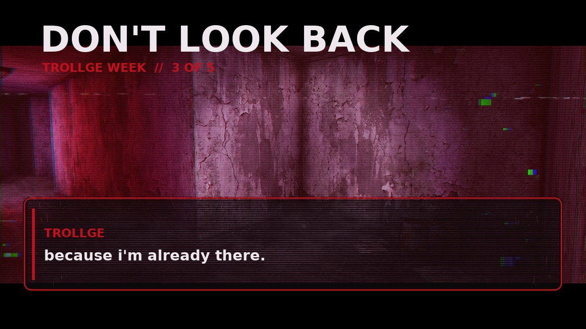
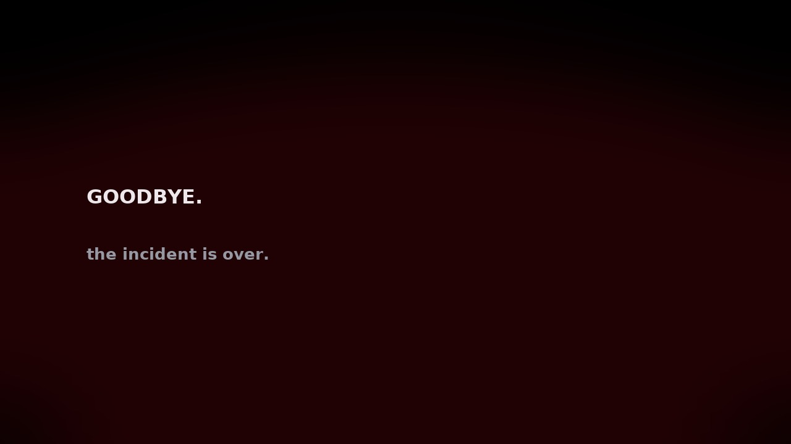

# 🎭 Super Scary Trollge — a Codename Engine mod

**Five songs. One trollge. It gets worse every time.**
A complete, playable [Codename Engine](https://github.com/CodenameCrew/CodenameEngine) mod where the horror
escalates song by song: **2/10 → 4/10 → 6/10 → 8/10 → 10/10** — and the characters, the arrows, the camera
and the HUD mutate with it.


| Song | Folder | Key | Scare | BPM | Sound | Length | Notes EZ/NM/HARD | Boyfriend | Trollge | Story beats |
| --- | --- | --- | --- | --- | --- | --- | --- | --- | --- | --- |
| **1. Trolling** | `trolling` | D minor | 2/10 | 140 | 8-bit **bounce** | 1:44 | 92 / 110 / 152 | `bf_blue` | `trollge` | 3 |
| **2. It's Getting Dark** | `getting-dark` | C minor | 4/10 | 150 | half-time **trap** | 1:43 | 108 / 128 / 176 | `bf_smiler` | `trollge` → `trollge_glitch` | 7 |
| **3. Don't Look Back** | `dont-look-back` | C# minor | 6/10 | 152 | **glitch** | 1:51 | 153 / 185 / 266 | `bf_glitched` | `trollge_glitch` → `trollge_static` | 10 |
| **4. Super Scary Trollge** | `super-scary` | B minor | 8/10 | 160 | **industrial** | 1:43 | 162 / 201 / 308 | `bf_super_scary` | `trollge_static` → `trollge_final` → `trollge_sad` | 13 |
| **5. The Incident** | `the-incident` | A minor | 10/10 | 170 | **finale** | 1:48 | 206 / 257 / 378 | `bf_damned` | `trollge_final` → `trollge_sad` | 16 |

Each song also ships its own **arrow skin**, from bright violet/mint to a corrupted glitch atlas:

| Song | Arrow skin | Look |
| --- | --- | --- |
| Trolling | `game/notes/default` | violet, blue, mint and crimson arrows with soft glow |
| It's Getting Dark | `game/notes/shadow` | the same arrows with the colour drained out |
| Don't Look Back | `game/notes/corrupt` | sliced, RGB-split, static-speckled arrows |
| Super Scary Trollge | `game/notes/corrupt` | the same corruption, now with two-lane chords behind it |
| The Incident | `game/notes/torn` | burnt through: ember red, ripped edges, more static |



All three base-game difficulties — **easy, normal, hard** — are charted for every song, with scroll speed rising per
difficulty (1.25 → 2.45 across the pack). Easy and normal are strided subsets of the hard chart (every second / two in
three notes), so nothing can drift: sustains and the finale's **two-lane chords** exist on hard only.

Charts are built the way the base game builds them: **one bar (16 steps) belongs to one character**, phrase blocks of
2–4 bars alternate `dad → bf`, the player sings the last phrase, every song opens with an intro block and breathes on
two breakdowns, and note density climbs 1.5 → 3.5 notes/second instead of 2.5 → 8.5. Song 5 is the longest and hardest.
The full reasoning, the base-game reference numbers and the engine citations are in **[docs/charting.md](docs/charting.md)**.

All five songs are in **freeplay** (via `data/config/freeplaySonglist/LIB_TrollgeMod.txt`, which lists them in
scare order) and in story mode (the week plays them back to back).


---

## Install

1. Get [Codename Engine](https://github.com/CodenameCrew/CodenameEngine) and make sure it runs.
2. Grab `SuperScaryTrollge-v3.3.0.zip` from the [releases page](../../releases) (or build it yourself, see below).
3. Drop the **zip** into `mods/` — or extract it so you get `mods/TrollgeMod/data/…`.
4. Launch the engine → **Mods** → pick **Super Scary Trollge**.
5. The week *SUPER SCARY TROLLGE* shows up in story mode, and all five songs are in freeplay.

```
mods/
└── TrollgeMod/
    ├── mod.json
    ├── data/
    │   ├── characters/   trollge.xml, trollge_glitch.xml, trollge_static.xml,
    │   │                 trollge_final.xml, trollge_sad.xml,
    │   │                 bf_blue.xml, bf_smiler.xml, bf_glitched.xml,
    │   │                 bf_super_scary.xml, bf_damned.xml (+ _dead variants)
    │   ├── config/       modpack.ini, freeplaySonglist/LIB_TrollgeMod.txt
    │   ├── scripts/      trollge_behavior.hx, trollge_song_behavior.hx
    │   ├── splashes/     default.xml (note splash config)
    │   ├── stages/       trollge.xml, trollge.hx
    │   └── weeks/        weeks/trollge_week.xml, characters/trollge.xml
    ├── images/           characters/, icons/, stages/, menus/, event overlays,
    │                     game/notes/{default,shadow,corrupt,torn}, game/splashes,
    │                     game/healthBar.png, game/{ready,set,go}.png
    ├── songs/            trolling/, getting-dark/, dont-look-back/,
    │                     super-scary/, the-incident/  (song/Inst.ogg +
    │                     song/Voices.ogg + charts/{easy,normal,hard}.json +
    │                     cutscene.hx + cutscene-end.hx)
    ├── shaders/          trollge_vhs.frag (the full-screen grade)
    ├── music/            gameOver.ogg + gameOver.ini (death theme + its BPM)
    └── sounds/           stingers, themes, countdown hits, custom hit/miss,
                          per-character note voices, game-over sting/retry
```

> **Codename Engine only.** Psych Engine / YoshiCrafter mods use a different format; this mod uses the
> Codename chart format (`chartVersion 1.6.0`, `codenameChart: true`) and HScript behaviours.

---

## What's inside

### The Trollge — five phases, one character

All Trollge art is hand-drawn and imported from `art_src/trollge/` by `tools/make_characters.py`:

| Phase | Art | Used by |
| --- | --- | --- |
| `trollge` | `trollge.png` — clean grin, hunched, clawed hands | song 1; song 2 (0–62 s) |
| `trollge_glitch` | `trollgeGlitch.png` — RGB-split, breaking apart | song 2 (62 s →); song 3 (0–75 s) |
| `trollge_static` | `trollgeStatic1.png` — hatched, buzzing with static | song 3 (75 s →); song 4 (0–60 s) |
| `trollge_final` | `TrollgeFinal.png` — red-eyed final form | song 4 (60–96 s); song 5 (0–84 s) |
| `trollge_sad` | `trollgesad.png` — one pose. he just stands there. | song 4 (96 s →); song 5 (84 s →) |

Every phase ships `idle`, all four sing poses, all four **miss** poses, `scared`, `laugh`, `attack`, `hit`,
`die` and its own health icon. The importer:

* renames frames to collision-free codes (`TrollgeF sUP0000`) so `addByPrefix` can never fold a miss pose
  into a sing animation,
* rebuilds `singRIGHT` by mirroring `singLEFT` — **the uploaded right-sing frames are a sprawled, upside-down
  figure**, so they are unusable,
* derives the miss poses (desaturated, blood-washed) because the uploads contain none,
* normalises everything onto one ground line and one body height, so a phase swap at 60 s cannot make him
  jump, grow or slide.

### The Boyfriend — one skin per song





`bf_blue` (song 1) → `bf_smiler` (song 2) → `bf_glitched` (song 3) → `bf_super_scary` (song 4) → `bf_damned`
(song 5). Songs 1–2 are imported straight from `art_src/bf/`; songs 3 and 5 are **re-coloured** from the same two
uploads with the importer's `tint` pass (`bf_glitched` = the blue boy gone sickly green, `bf_damned` = the crazy
boy burnt red and desaturated) — a real second cast without a second upload. The blue skin has no miss art in its
upload, so the importer grades its sing poses into blood-washed miss poses; every skin also gets a game-over sprite
(`gameOverChar`) and a two-frame health icon.

`tools/make_characters.py` is the only thing that writes character atlases/XML/icons:

```bash
python3 tools/make_characters.py                 # rebuild every character
python3 tools/make_characters.py trollge_final   # just one
```

### Story events

Charts call HScript functions through `HScript Call` events, implemented in
`data/scripts/trollge_song_behavior.hx`:

| Function | Effect |
| --- | --- |
| `trollgeJumpScare` | Full-screen scream built from the trollge's **own face**, stinger, white flash, camera shake |
| `trollgeToGlitch` | 62 s of song 2: the clean trollge corrupts where he stands |
| `trollgeToStatic` | 75 s of song 3: phase 2 collapses into phase 3 |
| `trollgeFinalForm` | 60 s of song 4: static mess → red-eyed final form, with a stinger + hard shake |
| `trollgeToSad` / `trollgeSad` | 84 s of song 5 / 96 s of song 4: he stops fighting. One pose. Stillness. |
| `trollgeScreenShake` | Camera + HUD shake with a red flash |
| `trollgeDistort` | Glitch overlay + shake |
| `trollgeStatic` | CRT static burst |
| `trollgeInvert` | Corrupted-frame overlay while reality flips |

Which beats fire when is data-driven: each song has an `events.json` with its own scare schedule
(Trolling: 3 beats, It's Getting Dark: 7, Don't Look Back: 10, Super Scary Trollge: 13, The Incident: 16).

The stage (`data/stages/trollge.hx`) reads `customValues.scareTier` from the song's `meta.json` and picks one of
five backdrops, plus how much ambient static to flicker:

| Tier | Backdrop |
| --- | --- |
| 2/10 | `bg.png` — dim, quiet |
| 4/10 | `bg_scary.png` — red bleed, scanlines, grain |
| 6/10 | `bg_glitch.png` — the room double-exposing on itself |
| 8/10 | `bg_nightmare.png` — RGB-split, corrupted |
| 10/10 | `bg_hell.png` — the original photograph, burning |

### Arrows, splashes and the HUD

The note skin is drawn in code by `tools/make_noteskin.py` (no borrowed FNF art) and follows the engine's
87-frame naming so it drops straight in:

* `images/game/notes/default.png/.xml` — 49 frames: idle strums (`arrowLEFT`…), `left press` and
  `left confirm` (4 frames each), the four scrolling notes (`purple`…`red`), hold bodies and hold caps.
* `images/game/notes/shadow.png/.xml` — same layout, colour drained (song 2).
* `images/game/notes/corrupt.png/.xml` — same layout, glitched (songs 3–4).
* `images/game/notes/torn.png/.xml` — same layout, burnt to ember and ripped (song 5).
* `images/game/splashes/default.png/.xml` + `data/splashes/default.xml` — the burst that fires when a note is
  hit, per lane, 4 frames each.

How each song gets its skin:

1. The chart's `noteTypes` list names the atlas (`["shadow"]`, `["corrupt"]`, `["torn"]`, `[]` = default). The engine maps
   note type `0` onto that name and loads `game/notes/<name>` — see `Note.hx`.
2. Strums always load `game/notes/default`, so `data/stages/trollge.hx` implements `onStrumCreation` and swaps
   `event.sprite` to the same atlas, keyed off the song's `customValues.scareTier`.

The HUD is themeable by filename alone, so `tools/make_hud.py` ships:

* `images/game/healthBar.png` — a bolted steel frame with a red inner shadow (the `FlxBar` is drawn 4 px
  inside it, and it repaints to the new form's `iconColor` when the Trollge swaps at 60 s / 96 s).
* `images/game/ready.png`, `set.png`, `go.png` — glitched READY / SET / GO badges.
* `sounds/intro3.ogg`, `intro2.ogg`, `intro1.ogg`, `introGo.ogg` — matching countdown hits, rising in pitch
  and ending in a distorted blast.



### Positioning and camera

The stage is not hand-placed and hoped for: `tools/make_stage_preview.py` re-implements the engine's framing
(`FlxAtlasFrames` frame offsets → `Character.__getCameraPositionInto` → `FlxCamera` zoom/scroll) and renders
`docs/stage.png` — one tile per camera side, with the ground line and each character's safe frame drawn in.



It prints the clear space around each character at the stage zoom **and** at the tightest zoom any song reaches,
and fails if anything is clipped, if the two pairs of feet are more than 2 px apart, or if the backdrop does not
cover what the camera can see. The numbers it validates:

| Setting | Value | Why |
| --- | --- | --- |
| ground line | Trollge `y=60`, Boyfriend `y=82` | the two atlases have different canvas heights (600 vs 560), so the y offset is exactly their baseline difference — the feet land on the same line to the pixel |
| character gap | 520 px | the camera swings between the two strumlines; this is the widest gap that still keeps both characters in frame with at least 45 px of clear space on the tightest zoom |
| `camyoffset` | 60 | without it the Trollge's feet sit on the bottom edge whenever the camera is on his side |
| `zoom` | 0.95 → 1.026 | the stage's 0.95 plus 0.0095 per scare step: song 1 is framed loose, song 5 is pressed in |

Camera work lives in `data/stages/trollge.hx` and scales with the scare tier, so the last two songs physically feel
different from the first one:

* a **zoom pulse** on every beat (`0.0022 + 0.0004 × tier`), pulled back by the engine's own lerp to `defaultCamZoom`;
* a **push on every fourth measure** and a **tiny push on every correct note** — a clean section visibly breathes;
* **screen shake** from 6/10 up on every beat, plus a 4 px slam every fourth beat at 10/10, on top of the scripted
  event shakes (which already scaled with the tier).

### Note-hit voices

The engine plays nothing when a note is hit (only miss sounds), so both sides used to mime silently. Now every hit
plays **that character's own syllable**, and the pitch follows the arrow — up is highest, down is lowest:

| Side | Sound | Files |
| --- | --- | --- |
| Player | bright nasal syllable | `sounds/bf_note_{up,down,left,right}.ogg` |
| Opponent | low growling syllable | `sounds/trollge_note_{up,down,left,right}.ogg` |

They are synthesised in `tools/make_audio.py` (`render_note_voices()`), triggered from the stage script's
`onNoteHit` hook, and skipped for sustain ticks so holds do not machine-gun. The sing poses themselves are the
engine's own (`singLEFT`…), so a correct arrow gives you **the pose and the voice** for whichever side is singing.

### Audio

All audio is synthesised with numpy (`tools/make_audio.py`) at 44.1 kHz stereo, exported as OGG/Vorbis.

**The instrumentals are built from the chart notes**, and the takes are played, not programmed: every hit gets a
deterministic timing nudge and velocity (swing on the off-16ths, a few milliseconds of human drift), the pads carry a
seventh with a slowly moving filter, ghost snares and open hats fill the space between the drums, an eight-bar fill
lands into every new role, the lead is doubled an octave down for weight, and the master runs tape saturation plus a
parallel-compressed mid so the drums feel loud without flattening the dynamics. Each song is arranged by *section role* — the renderer labels
every chart section and gives it a part, so the songs build, drop and breathe instead of looping one drum pattern:

| Role | Where it lands | What plays |
| --- | --- | --- |
| `intro` | section 1 | pad, one kick, off-beat hats, no snare |
| `verse` | most sections | kick on 1 + 3, snare on 2 + 4, 8th hats, walking bass |
| `build` | every 4th section | verse + 16th hats and a busier bass |
| `drop` | blocks with 16th-note cells | syncopated 16th bass, extra kicks, 16th hats, air sizzle |
| `break` | mid-song + just before the finale | half-time heartbeat, open hats, most of the mix gone |
| `finale` | last two sections | drop + octave-doubled lead |

**Five songs, five bands.** The songs do not share instruments — same renderer, different kit, bass voice, lead voice
and groove (`"style"` in `tools/song_layout.py`, voices in `tools/make_audio.py`):

| Style | Kit | Bass | Lead | Groove |
| --- | --- | --- | --- | --- |
| `bounce` (song 1) | punchy kick, layered **clap**, open hats, woodblock answers | plucked saw, 8th-note bounce | pulse-wave **chip** lead | straight backbeat, off-beat bass |
| `trap` (song 2) | long **808** boom, rim-shot snare, rolling/ triplet hats | sliding 808 sub, long notes | two-operator **FM bell** with a tail | half-time, reversed cymbals |
| `glitch` (song 3) | clipped sub thump, gate-stuttered snare, hat holes and 32nd stutters | sample-and-hold octave corruption | bitcrushed square with random dropouts | broken beat: kick on 1 and the "a" of 2 |
| `industrial` (song 4) | distorted metal kick, ghost snares, 16th ride | crushed detuned saw, 16ths | screaming saw + tritone, bitcrushed | four-on-the-floor, noise bursts |
| `finale` (song 5) | double kick, blast-beat snares, 16th rolls, gong hits | sub + distorted saw octave | choir of detuned saws with fifths | driving 8ths with a fifth stab |

`tools/audit_songs.py` measures that separation too: the minimum pairwise song "fingerprint" distance (band energy +
centroid + onset rate) has to stay above 0.10, and it currently reads **0.33**.

On top of that: snare fills and a riser + crash into every section that gets bigger, a horror layer per scare tier
(dread drone → tape hiss → whisper swells → a breathing, detuned tritone → heartbeat, whispers and a choir root),
scripted stingers behind every `HScript Call` event, and a **real ending**
— the instruments stop two beats early so the last chord, crash and sub drop ring out (no lazy fade-out).

**Mixing and mastering.** Parts are rendered as mono stems and placed in stereo; bass and kick stay centred, hats,
pads and leads are panned apart, the lead reverb doubles as a snare room with a Haas delay, and the pads and bass are
sidechained to the kick. The master chain is graphic EQ (sub cut, presence + air lift) → gentle glue compression →
mid/side widener with mono bass → loudness normalisation to −15.5 dBFS RMS → limiter with 2 dB of headroom, because
Vorbis overshoots the source peak — so the encoder **decodes its own output** and re-normalises if the file clips
(`write_song()`), and the audit reports the 4x-oversampled true peak of the shipped OGG. Nothing in the package
peaks above −0.7 dBTP.

Every one of those claims is **measured**, not vibes: `tools/audit_songs.py` decodes the shipped `Inst.ogg` files and
checks loudness, crest factor, section dynamics, spectral balance, stereo width, side/mid ratio, clipping and DC —
plus chart style (off-beat ratio, same-lane runs, density curve). The results live in
[`docs/song_report.md`](docs/song_report.md) and CI fails if a metric leaves its window.

* `songs/<id>/song/Inst.ogg` — the instrumental; kick/snare/hats, sub bass, pads, and an arpeggio lead whose pitches
  come straight from the note ids.
* `sounds/trollge_jump_scare.ogg`, `trollge_distortion.ogg`, `trollge_invert.ogg` — event stingers.
* `sounds/trollge_hit.ogg`, `trollge_miss.ogg` — custom note feedback.
* `sounds/trollge_theme.ogg`, `trollge_theme_scary.ogg` — 24 s music-box loops, free to use in menus/cutscenes.
* `sounds/intro3.ogg`, `intro2.ogg`, `intro1.ogg`, `introGo.ogg` — the countdown: three tuned hits and a blast.

### Screen grade (shader)

`shaders/trollge_vhs.frag` is a full-screen post filter applied to `camGame` by `data/stages/trollge.hx`:

* banded VHS wobble, radial chromatic aberration, a 5-tap **halation** glow on highlights, drifting scanlines,
  film grain, vignette, then a small contrast/saturation lift so the grade sharpens the picture instead of washing
  it out;
* intensity follows the scare tier (0.35 / 0.51 / 0.67 / 0.83 / 1.0) and every story event in the chart (`trollgeJumpScare`,
  `trollgeInvert`, `trollgePhase2`…) punches `uGlitch` for 1.2 s; song 3 also twitches on every beat;
* all sampling is **clamped to the texture**, so the offsets never pull from outside the frame — that was causing
  the edges of the screen to smear/clip on the first pass;
* the stage script resolves `FunkinShader` and `openfl.filters.ShaderFilter` at runtime and silently disables the
  grade if the platform has no GPU path, so the mod still runs without it.


`tools/make_grade_preview.py` reproduces the shader maths in numpy (same uniforms, same order) and renders
`docs/grade.png` — raw backdrop on the left, graded on the right, one row per scare tier — so the look can be
reviewed without launching the engine.

The validator checks the shader file for `#pragma header`, a `main()`, no `switch` statements, no reversed
`smoothstep` edges, and that every uniform it declares is actually set by the stage script.

---

## Cutscenes and the ending

Codename looks for cutscenes by itself, so all of it is data:

```
songs/<song>/cutscene.hx        PlayState.createPost -> startCutscene(...)   (intro, Story Mode)
songs/<song>/cutscene-end.hx    PlayState -> startCutscene("end-", ...)      (outro, Story Mode)
images/ui/cutscene_frame*.png   the dialogue frame          images/ui/cutscene_bar_*.png   letterbox
images/ui/cutscene_veil.png     the ending veil
```

The intro is a short cinematic before the countdown: letterbox bars slide in, the song title lands, then the Trollge
and BF trade typed lines in VCR with a speakers label, a stinger and a **camera shake on the lines that deserve one**
(`SHAKES` in `tools/song_layout.py`). `ENTER` / `SPACE` / `ESC` skips. The HUD is hidden for the duration and restored
in `destroy()`, and everything draws on its own camera so the stage keeps animating behind it.

**In-song captions.** The story does not stop when the countdown does: each song carries three to five caption beats
(`"captions"` in `tools/song_layout.py`) that are emitted as chart events and typed across the bottom of the screen
while you play — `don't look back`, `you looked`, `the first scream`, `goodbye`. They use the HUD camera, never block
input, and fade themselves out.

The outro runs after the last note. For songs 1–4 it is one line of falling action; **The Incident** gets the real
ending: the screen fades under the final chord and `GOODBYE.` / `he stopped fighting.` / `the incident is over.` /
`…or maybe it never ended.` type themselves out before control returns to the engine.





Both scripts are generated by `tools/make_cutscenes.py` from `tools/song_layout.py`, so the copy you read and the copy
the audio was built from cannot drift — and `tools/validate_mod.py` checks the scripts reference images and sounds that
actually ship, restore the HUD, and free their camera.

## The death screen

Codename's game-over state is three files and one ini, so the mod ships all four:

```
music/gameOver.ogg     a 16 s dirge: D minor drone, a tritone that will not resolve,
music/gameOver.ini     heartbeat, a music box playing the Trollge motif a semitone wrong   (BPM = 76)
sounds/gameOverSFX.ogg the mic drop -- sub hit, static burst, a ringing tone
sounds/gameOverEnd.ogg the retry whoosh
```

`tools/validate_mod.py` checks all four exist, that the ini actually carries a BPM, and that the durations are sane —
because a missing file silently falls back to the base game's death theme, which is the loudest "unfinished" tell a
mod can have.

## How the charts work

`tools/song_layout.py` is the single source of truth: it defines the BPM, the key, the chord progression, the phrase
blocks (`section_measures` in bars), the rhythm cell of each block (`cells`), the difficulty filters, the characters
each song uses, and the story beats for all five songs. `tools/make_chart.py` and `tools/make_audio.py` both read it, so **the music and the chart can
never drift apart**.

Charts are written in Codename's own format:

```json
{
  "stage": "trollge",
  "scrollSpeed": 1.0,
  "chartVersion": "1.6.0",
  "codenameChart": true,
  "bookmarks": [{ "time": 1142.857, "name": "01 - WAKE UP", "color": "#6E0D1B" }],
  "strumLines": [
    { "position": "dad", "type": 0, "characters": ["trollge_static"], "keyCount": 4,
      "notes": [{ "time": 1142.857, "id": 0, "type": 0, "sLen": 0 }] }
  ]
}
```

Each song ships 16–28 named phrase bookmarks (marked `(dad)` when the opponent sings) so the editor shows the song
structure at a glance, plus its own `song/Voices.ogg` — the characters actually sing, which is what `needsVoices`
gates in `PlayState.hx`.

**Melody first, then arrows.** Every song has a four-note *hook* (`"hooks"` in `tools/song_layout.py`): the opponent
sings the call, the player answers with it, and the answer inverts every fourth exchange. The chart's lanes *are* the
melody — the audio renders the same lanes as pitches — so the hook you hear is the hook you play, and it never repeats
at the same pitch because the chords move underneath it. Every phrase lands its last note on the root.

---

## Rebuilding the assets

Everything is reproducible. Requirements: Python 3.10+, `pillow`, `numpy`, `soundfile`.

```bash
pip install pillow numpy soundfile

python3 tools/make_characters.py  # imported atlases -> normalised atlases, icons, character XML (~25 s)
python3 tools/make_art.py         # backdrops, VHS overlays, week banner, previews (~10 s)
python3 tools/make_audio.py       # 5 instrumentals + 5 vocal tracks + stingers/themes/note voices (~18 min)
python3 tools/make_noteskin.py    # arrow skins (default/shadow/corrupt/torn) + splashes (~12 s)
python3 tools/make_hud.py         # health bar frame + READY/SET/GO badges
python3 tools/make_chart.py       # meta.json, events.json, charts {easy,normal,hard}
python3 tools/make_cutscenes.py   # cutscene scripts + their frames/letterbox art (~2 s)
python3 tools/make_promo.py       # docs/banner.jpg from the real stage art (~1 s)
python3 tools/make_stage_preview.py  # engine framing check -> docs/stage.png + margin report
python3 tools/validate_mod.py     # ~2180 checks: schemas, atlas bounds, skins, HUD, note times, audio length, one character per bar...
python3 tools/audit_songs.py      # mix + chart-style metrics -> docs/song_report.md (--strict for CI)
python3 tools/package_mod.py      # dist/SuperScaryTrollge-v3.3.0.zip (161 files, includes shaders/ + music/)
```

Want a different song? Edit `tools/song_layout.py` (phrase blocks, rhythm cells, progression, key, scare tier, event
times) and re-run the generators — the charts, the instrumental, the vocal track, the week and the freeplay list all
follow.

---

## CI

`.github/workflows/build.yml` runs on every push and PR:

1. **Validate** — JSON/XML schemas, atlas frame bounds, animation-prefix collisions, note/time sanity,
   `HScript Call` targets actually exist, every chart character + animation resolves, `Inst.ogg` duration
   matches the chart length, note-skin frame sets match across skins, splash anims resolve in their atlas,
   HUD art is sane. Then `tools/audit_songs.py --strict` measures the mix (loudness, dynamics, spectral
   balance, stereo width, clipping) and the chart style (off-beat ratio, jacks, density escalation).
2. **Charts in sync** — regenerates the charts and fails if the committed files drifted.
3. **Release** — pushing a `v*` tag builds the zip and publishes it.

---

## Credits

* **Engine:** [Codename Engine](https://github.com/CodenameCrew/CodenameEngine) by CodenameCrew (Apache-2.0).
* **Boyfriend / stage audio-engine conventions:** Friday Night Funkin' by Funkin' Crew.
* **Trollge and Boyfriend art (`art_src/`):** drawn by the project owner and imported unchanged by
  `tools/make_characters.py` — credited to them, not covered by this repo's MIT licence.
* **Charts, music, scripts, backdrops, overlays, tooling:** made for this repo (MIT, see `LICENSE`).
* **Stage backdrops:** graded from a horror backdrop image in `art_src/scary_bg.png`.

Trollge is an internet meme of unknown origin; this mod is a non-commercial fan project.
