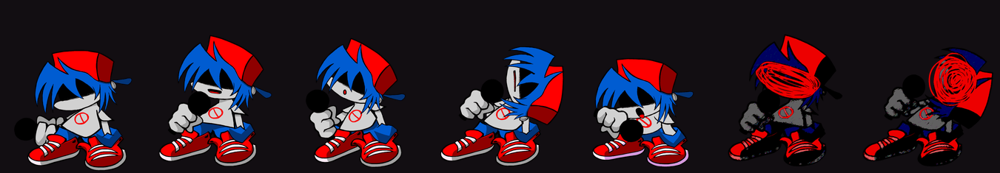

# 🎭 Super Scary Trollge — a Codename Engine mod

**Three songs. One trollge. It gets worse every time.**
A complete, playable [Codename Engine](https://github.com/CodenameCrew/CodenameEngine) mod where the horror
escalates song by song: **2/10 → 4/10 → 7/10** — and the characters, the arrows and the HUD mutate with it.


| Song | Scare | BPM | Sound | Length | Notes (normal) | Boyfriend | Trollge | Story beats |
| --- | --- | --- | --- | --- | --- | --- | --- | --- |
| **1. Trolling** | 2/10 | 140 | 8-bit **bounce** | 104.0 s | 256 | `bf_blue` | `trollge` (phase 1) | 3 |
| **2. It's Getting Dark** | 4/10 | 150 | half-time **trap** | 103.6 s | 320 | `bf_smiler` | `trollge_glitch` (phase 2) | 6 |
| **3. Super Scary Trollge** | 7/10 | 160 | **industrial** | 103.5 s | 658 | `bf_super_scary` | `trollge_static` → `trollge_final` → `trollge_sad` | 13 |

Each song also ships its own **arrow skin**, from bright violet/mint to a corrupted glitch atlas:

| Song | Arrow skin | Look |
| --- | --- | --- |
| Trolling | `game/notes/default` | violet, blue, mint and crimson arrows with soft glow |
| It's Getting Dark | `game/notes/shadow` | the same arrows with the colour drained out |
| Super Scary Trollge | `game/notes/corrupt` | sliced, RGB-split, static-speckled arrows |


Both **easy** and **normal** difficulties are charted for all three songs (easy = half density, no sustains).
Sustains land every other section, and the last three sections of song 3 drop **two-lane chords on the beat** — that is
what takes it from a 4/10 chart to a 7/10 one.


---

## Install

1. Get [Codename Engine](https://github.com/CodenameCrew/CodenameEngine) and make sure it runs.
2. Grab `SuperScaryTrollge-v2.4.0.zip` from the [releases page](../../releases) (or build it yourself, see below).
3. Drop the **zip** into `mods/` — or extract it so you get `mods/TrollgeMod/data/…`.
4. Launch the engine → **Mods** → pick **Super Scary Trollge**.
5. The week *SUPER SCARY TROLLGE* shows up in story mode, and all three songs are in freeplay.

```
mods/
└── TrollgeMod/
    ├── mod.json
    ├── data/
    │   ├── characters/   trollge.xml, trollge_glitch.xml, trollge_static.xml,
    │   │                 trollge_final.xml, trollge_sad.xml,
    │   │                 bf_blue.xml, bf_smiler.xml, bf_super_scary.xml (+ _dead variants)
    │   ├── config/       modpack.ini
    │   ├── scripts/      trollge_behavior.hx, trollge_song_behavior.hx
    │   ├── splashes/     default.xml (note splash config)
    │   ├── stages/       trollge.xml, trollge.hx
    │   └── weeks/        weeks/trollge_week.xml, characters/trollge.xml
    ├── images/           characters/, icons/, stages/, menus/, event overlays,
    │                     game/notes/{default,shadow,corrupt}, game/splashes,
    │                     game/healthBar.png, game/{ready,set,go}.png
    ├── songs/            trolling/, getting_dark/, super_scary/
    └── sounds/           stingers, themes, countdown hits, custom hit/miss
```

> **Codename Engine only.** Psych Engine / YoshiCrafter mods use a different format; this mod uses the
> Codename chart format (`chartVersion 1.6.0`, `codenameChart: true`) and HScript behaviours.

---

## What's inside

### The Trollge — five phases, one character

All Trollge art is hand-drawn and imported from `art_src/trollge/` by `tools/make_characters.py`:

| Phase | Art | Used by |
| --- | --- | --- |
| `trollge` | `trollge.png` — clean grin, hunched, clawed hands | song 1 |
| `trollge_glitch` | `trollgeGlitch.png` — RGB-split, breaking apart | song 2 |
| `trollge_static` | `trollgeStatic1.png` — hatched, buzzing with static | song 3 (0–60 s) |
| `trollge_final` | `TrollgeFinal.png` — red-eyed final form | song 3 (60 s →) |
| `trollge_sad` | `trollgesad.png` — one pose. he just stands there. | song 3 (96 s →) |

Every phase ships `idle`, all four sing poses, all four **miss** poses, `scared`, `laugh`, `attack`, `hit`,
`die` and its own health icon. The importer:

* renames frames to collision-free codes (`TrollgeF sUP0000`) so `addByPrefix` can never fold a miss pose
  into a sing animation,
* rebuilds `singRIGHT` by mirroring `singLEFT` — **the uploaded right-sing frames are a sprawled, upside-down
  figure**, so they are unusable,
* derives the miss poses (desaturated, blood-washed) because the uploads contain none,
* normalises everything onto one ground line and one body height, so a phase swap at 60 s cannot make him
  jump, grow or slide.

### The Boyfriend — one skin per song




`bf_blue` (song 1) → `bf_smiler` (song 2) → `bf_super_scary` (song 3), imported from `art_src/bf/`.
The blue skin has no miss art in its upload, so the importer grades its sing poses into blood-washed
miss poses; every skin also gets a game-over sprite (`gameOverChar`) and a two-frame health icon.

`tools/make_characters.py` is the only thing that writes character atlases/XML/icons:

```bash
python3 tools/make_characters.py                 # rebuild every character
python3 tools/make_characters.py trollge_final   # just one
```

### Story events

Charts call HScript functions through `HScript Call` events, implemented in
`data/scripts/trollge_song_behavior.hx`:

| Function | Effect |
| --- | --- |
| `trollgeJumpScare` | Full-screen scream built from the trollge's **own face**, stinger, white flash, camera shake |
| `trollgeFinalForm` | 60 s of song 3: static mess → red-eyed final form, with a stinger + hard shake |
| `trollgeSad` | 96 s of song 3: he stops fighting. One pose. Stillness. |
| `trollgeScreenShake` | Camera + HUD shake with a red flash |
| `trollgeDistort` | Glitch overlay + shake |
| `trollgeStatic` | CRT static burst |
| `trollgeInvert` | Corrupted-frame overlay while reality flips |

Which beats fire when is data-driven: each song has an `events.json` with its own scare schedule
(Trolling: 3 beats, It's Getting Dark: 6, Super Scary Trollge: 13 — four jumpscares, two inversions and a
phase change).

The stage (`data/stages/trollge.hx`) reads `customValues.scareTier` from the song's `meta.json` and picks one of
three backdrops, plus how much ambient static to flicker:

| Tier | Backdrop |
| --- | --- |
| 2/10 | `bg.png` — dim, quiet |
| 4/10 | `bg_scary.png` — red bleed, scanlines, grain |
| 7/10 | `bg_nightmare.png` — RGB-split, corrupted |

### Arrows, splashes and the HUD

The note skin is drawn in code by `tools/make_noteskin.py` (no borrowed FNF art) and follows the engine's
87-frame naming so it drops straight in:

* `images/game/notes/default.png/.xml` — 49 frames: idle strums (`arrowLEFT`…), `left press` and
  `left confirm` (4 frames each), the four scrolling notes (`purple`…`red`), hold bodies and hold caps.
* `images/game/notes/shadow.png/.xml` — same layout, colour drained (song 2).
* `images/game/notes/corrupt.png/.xml` — same layout, glitched (song 3).
* `images/game/splashes/default.png/.xml` + `data/splashes/default.xml` — the burst that fires when a note is
  hit, per lane, 4 frames each.

How each song gets its skin:

1. The chart's `noteTypes` list names the atlas (`["shadow"]`, `["corrupt"]`, `[]` = default). The engine maps
   note type `0` onto that name and loads `game/notes/<name>` — see `Note.hx`.
2. Strums always load `game/notes/default`, so `data/stages/trollge.hx` implements `onStrumCreation` and swaps
   `event.sprite` to the same atlas, keyed off the song's `customValues.scareTier`.

The HUD is themeable by filename alone, so `tools/make_hud.py` ships:

* `images/game/healthBar.png` — a bolted steel frame with a red inner shadow (the `FlxBar` is drawn 4 px
  inside it, and it repaints to the new form's `iconColor` when the Trollge swaps at 60 s / 96 s).
* `images/game/ready.png`, `set.png`, `go.png` — glitched READY / SET / GO badges.
* `sounds/intro3.ogg`, `intro2.ogg`, `intro1.ogg`, `introGo.ogg` — matching countdown hits, rising in pitch
  and ending in a distorted blast.


### Audio

All audio is synthesised with numpy (`tools/make_audio.py`) at 44.1 kHz stereo, exported as OGG/Vorbis.

**The instrumentals are built from the chart notes.** Each song is arranged by *section role* — the renderer labels
every chart section and gives it a part, so the songs build, drop and breathe instead of looping one drum pattern:

| Role | Where it lands | What plays |
| --- | --- | --- |
| `intro` | section 1 | pad, one kick, off-beat hats, no snare |
| `verse` | most sections | kick on 1 + 3, snare on 2 + 4, 8th hats, walking bass |
| `build` | every 4th section | verse + 16th hats and a busier bass |
| `drop` | dense sections (spacing ≤ 2) | syncopated 16th bass, extra kicks, 16th hats, air sizzle |
| `break` | mid-song + just before the finale | half-time heartbeat, open hats, most of the mix gone |
| `finale` | last two sections | drop + octave-doubled lead |

**Three songs, three bands.** The songs do not share instruments — same renderer, different kit, bass voice, lead voice
and groove (`"style"` in `tools/song_layout.py`, voices in `tools/make_audio.py`):

| Style | Kit | Bass | Lead | Groove |
| --- | --- | --- | --- | --- |
| `bounce` (song 1) | punchy kick, layered **clap**, open hats, woodblock answers | plucked saw, 8th-note bounce | pulse-wave **chip** lead | straight backbeat, off-beat bass |
| `trap` (song 2) | long **808** boom, rim-shot snare, rolling/ triplet hats | sliding 808 sub, long notes | two-operator **FM bell** with a tail | half-time, reversed cymbals |
| `industrial` (song 3) | distorted metal kick, ghost snares, 16th ride | crushed detuned saw, 16ths | screaming saw + tritone, bitcrushed | four-on-the-floor, noise bursts |

`tools/audit_songs.py` measures that separation too: the minimum pairwise song "fingerprint" distance (band energy +
centroid + onset rate) has to stay above 0.10, and it currently reads **0.39**.

On top of that: snare fills and a riser + crash into every section that gets bigger, a horror layer per scare tier
(dread drone → tape hiss → whisper swells), scripted stingers behind every `HScript Call` event, and a **real ending**
— the instruments stop two beats early so the last chord, crash and sub drop ring out (no lazy fade-out).

**Mixing and mastering.** Parts are rendered as mono stems and placed in stereo; bass and kick stay centred, hats,
pads and leads are panned apart, the lead reverb doubles as a snare room with a Haas delay, and the pads and bass are
sidechained to the kick. The master chain is graphic EQ (sub cut, presence + air lift) → gentle glue compression →
mid/side widener with mono bass → loudness normalisation to −15.5 dBFS RMS → limiter with 2 dB of headroom, because
Vorbis overshoots the source peak — so the encoder **decodes its own output** and re-normalises if the file clips
(`write_song()`), and the audit reports the 4x-oversampled true peak of the shipped OGG. Nothing in the package
peaks above −0.9 dBTP.

Every one of those claims is **measured**, not vibes: `tools/audit_songs.py` decodes the shipped `Inst.ogg` files and
checks loudness, crest factor, section dynamics, spectral balance, stereo width, side/mid ratio, clipping and DC —
plus chart style (off-beat ratio, same-lane runs, density curve). The results live in
[`docs/song_report.md`](docs/song_report.md) and CI fails if a metric leaves its window.

* `songs/<id>/song/Inst.ogg` — the instrumental; kick/snare/hats, sub bass, pads, and an arpeggio lead whose pitches
  come straight from the note ids.
* `sounds/trollge_jump_scare.ogg`, `trollge_distortion.ogg`, `trollge_invert.ogg` — event stingers.
* `sounds/trollge_hit.ogg`, `trollge_miss.ogg` — custom note feedback.
* `sounds/trollge_theme.ogg`, `trollge_theme_scary.ogg` — 24 s music-box loops, free to use in menus/cutscenes.
* `sounds/intro3.ogg`, `intro2.ogg`, `intro1.ogg`, `introGo.ogg` — the countdown: three tuned hits and a blast.

### Screen grade (shader)

`shaders/trollge_vhs.frag` is a full-screen post filter applied to `camGame` by `data/stages/trollge.hx`:

* banded VHS wobble, radial chromatic aberration, a 5-tap **halation** glow on highlights, drifting scanlines,
  film grain, vignette, then a small contrast/saturation lift so the grade sharpens the picture instead of washing
  it out;
* intensity follows the scare tier (0.35 / 0.62 / 1.0) and every story event in the chart (`trollgeJumpScare`,
  `trollgeInvert`, `trollgePhase2`…) punches `uGlitch` for 1.2 s; song 3 also twitches on every beat;
* all sampling is **clamped to the texture**, so the offsets never pull from outside the frame — that was causing
  the edges of the screen to smear/clip on the first pass;
* the stage script resolves `FunkinShader` and `openfl.filters.ShaderFilter` at runtime and silently disables the
  grade if the platform has no GPU path, so the mod still runs without it.


`tools/make_grade_preview.py` reproduces the shader maths in numpy (same uniforms, same order) and renders
`docs/grade.png` — raw backdrop on the left, graded on the right, one row per scare tier — so the look can be
reviewed without launching the engine.

The validator checks the shader file for `#pragma header`, a `main()`, no `switch` statements, no reversed
`smoothstep` edges, and that every uniform it declares is actually set by the stage script.

---

## How the charts work

`tools/song_layout.py` is the single source of truth: it defines the BPM, chord progression, section list
(`count` notes per section, `spacing` in 16ths), the characters each song uses, and the story beats for all
three songs. `tools/make_chart.py` and `tools/make_audio.py` both read it, so **the music and the chart can
never drift apart**.

Charts are written in Codename's own format:

```json
{
  "stage": "trollge",
  "scrollSpeed": 1.0,
  "chartVersion": "1.6.0",
  "codenameChart": true,
  "bookmarks": [{ "time": 1142.857, "name": "01 - WAKE UP", "color": "#6E0D1B" }],
  "strumLines": [
    { "position": "dad", "type": 0, "characters": ["trollge_static"], "keyCount": 4,
      "notes": [{ "time": 1142.857, "id": 0, "type": 0, "sLen": 0 }] }
  ]
}
```

Each song ships 16–20 named section bookmarks so the charter shows the song structure at a glance.

---

## Rebuilding the assets

Everything is reproducible. Requirements: Python 3.10+, `pillow`, `numpy`, `soundfile`.

```bash
pip install pillow numpy soundfile

python3 tools/make_characters.py  # imported atlases -> normalised atlases, icons, character XML (~25 s)
python3 tools/make_art.py         # backdrops, VHS overlays, week banner, previews (~10 s)
python3 tools/make_audio.py       # 3 instrumentals + stingers + themes + countdown (~40 s)
python3 tools/make_noteskin.py    # arrow skins (default/shadow/corrupt) + splashes (~10 s)
python3 tools/make_hud.py         # health bar frame + READY/SET/GO badges
python3 tools/make_chart.py       # meta.json, events.json, charts for all difficulties
python3 tools/validate_mod.py     # 1182 checks: schemas, atlas bounds, skins, HUD, note times, audio length...
python3 tools/audit_songs.py      # mix + chart-style metrics -> docs/song_report.md (--strict for CI)
python3 tools/package_mod.py      # dist/SuperScaryTrollge-v2.4.0.zip
```

Want a different song? Edit `tools/song_layout.py` (spacings, progression, scare tier, event times) and re-run
the three generators — the chart, the instrumental and the stingers all follow.

---

## CI

`.github/workflows/build.yml` runs on every push and PR:

1. **Validate** — JSON/XML schemas, atlas frame bounds, animation-prefix collisions, note/time sanity,
   `HScript Call` targets actually exist, every chart character + animation resolves, `Inst.ogg` duration
   matches the chart length, note-skin frame sets match across skins, splash anims resolve in their atlas,
   HUD art is sane. Then `tools/audit_songs.py --strict` measures the mix (loudness, dynamics, spectral
   balance, stereo width, clipping) and the chart style (off-beat ratio, jacks, density escalation).
2. **Charts in sync** — regenerates the charts and fails if the committed files drifted.
3. **Release** — pushing a `v*` tag builds the zip and publishes it.

---

## Credits

* **Engine:** [Codename Engine](https://github.com/CodenameCrew/CodenameEngine) by CodenameCrew (Apache-2.0).
* **Boyfriend / stage audio-engine conventions:** Friday Night Funkin' by Funkin' Crew.
* **Trollge and Boyfriend art (`art_src/`):** drawn by the project owner and imported unchanged by
  `tools/make_characters.py` — credited to them, not covered by this repo's MIT licence.
* **Charts, music, scripts, backdrops, overlays, tooling:** made for this repo (MIT, see `LICENSE`).
* **Stage backdrops:** graded from a horror backdrop image in `art_src/scary_bg.png`.

Trollge is an internet meme of unknown origin; this mod is a non-commercial fan project.
